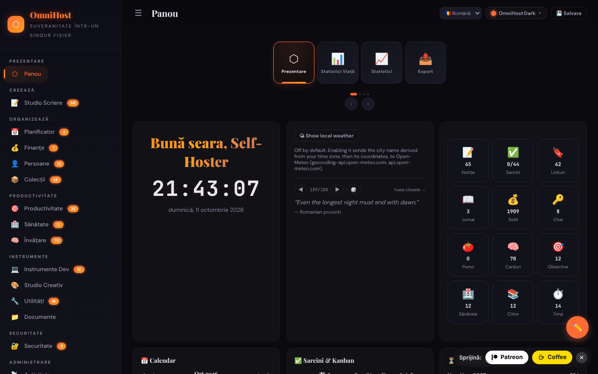

# OmniHost

[English](README.md) · [Română](README.ro.md) · [Français](README.fr.md) · [Italiano](README.it.md) · [Español](README.es.md) · [Português](README.pt.md) · **Deutsch** · [Magyar](README.hu.md)

**Version:** 1.3.0 · **Zuletzt aktualisiert:** 2026-10-19

Persönliche Produktivitätssuite in einer einzigen HTML-Datei („Quine“): Notizen, Planer, Finanzen, Lernen, Werkzeuge und viele Module, inspiriert von YunoHost.

**Online:** https://chiuta.github.io/OmniHost/

## Was es ist

OmniHost ist eine Datei `index.html` (~4 MB), die als vollständige persönliche Anwendung funktioniert, ohne Server und ohne Konto. Die Daten werden in einem JSON-Objekt innerhalb der Datei gehalten (`omnihost-store`); die Schaltfläche „Save“ lädt eine Kopie der App mit allen eingebetteten Daten herunter. Die Oberfläche zeigt „141 Modules“, und die Beschreibung auf der Seite nennt es „Single-File Sovereignty“. Die Standardoberfläche ist auf Englisch.

## Funktionen

Die Seitenleisten gruppieren die Module (mit der in der App angezeigten Anzahl der Elemente):

- **Overview:** Dashboard (Karte mit Begrüßung, Uhr, Wetter, Zitat, Schnellstatistiken, Kalender, Aufgaben / Kanban, Countdown, Aktivität, „About OmniHost“), Life Stats, Stats, Export.
- **Create:** Writing Studio (Notes, Journal, Scratch, Blog, Meetings, Letters, Changelog, Knowledge, Citations, Editor, Prompts, Pipeline, Quotes).
- **Organize:** Planner (Kalender, Woche, Jahr, Routinen, Mahlzeiten, Putzplan, Sprint), Finance, People, Collections.
- **Productivity**, **Health**, **Learning** (einschließlich Karteikarten / Flashcards).
- **Tools:** Dev Toolkit, Creative Studio, Utilities (einschließlich Wörterbuch und Übersetzung, QR-Generator und -Scanner), Documents.
- **Secure:** Security (einschließlich Schlüssel). **Meta:** Activity, Settings.
- Zeitleisten (Universum, Galaxie, Sonnensystem, geologisch, historisch usw.) und ein eingebautes Wiki mit Modulanleitungen, in Notes.
- 30 visuelle Themes und ein „Custom Studio“; Bearbeitungsmodus des Dashboards (Umordnen per Ziehen, Größenänderung).
- Oberfläche in 71 Sprachen, darunter Rumänisch.
- Schneller Modulumschalter (`Ctrl/Cmd+K`).
- JSON-Export / -Import, Zurücksetzen auf „Clean Quine“, Quelltextansicht und eine Seite „Licenses“ (Danksagungen für Komponenten, darunter jsQR und qrcodejs).

## Neue Funktionen (1.1.0)

- **Suche in Notizen und Tagebuch** im Umschalter `Ctrl/Cmd+K`: Unter der Modulliste erscheint der Abschnitt „In Notizen und Tagebuch“ (BM25, Toleranz gegenüber Tippfehlern, Diakritika werden ignoriert); ein Klick oder die Eingabetaste öffnet die Notiz oder den Tagebucheintrag.
- `.fff.json`-Sicherung (gemeinsames Modul „fff-kit“, lokal, ohne Netzwerk): Sie öffnet sich über den Dialog, der beim Klick auf die Version in der Fußzeile erscheint (Export, passwortverschlüsselter Export, Import mit Bestätigung, Löschen der App-Daten). Die Sicherung umfasst die Datenbank der App (`omnihost_db`); beim Import hat die importierte Kopie Vorrang vor den Daten in der Datei. Ein Export markiert die „letzte Sicherung“.
- Der Dialog des Umschalters hat jetzt die Dialog-Rolle (Barrierefreiheit). Die vorhandenen Inline-Handler wurden nicht verändert.
- Die neuen Texte sind auf Rumänisch und Englisch (die anderen Sprachen verwenden Englisch); **die Übersetzung wurde nicht von einem Muttersprachler geprüft.**
- `fff.config.json` kennzeichnet die App als „selbstverändernd“ (die Schaltfläche Save lädt eine Kopie mit eingebetteten Daten herunter); der Dialog des Kits warnt, dass sich der Hash der gespeicherten Kopie unterscheidet.

## Bedienungsanleitung

1. Öffne `index.html`. Gehe im Dashboard die Entdeckungsaufgaben in der Liste „Tasks“ durch.
2. Navigiere über die Seitenleiste zwischen den Modulen (☰ auf schmalen Bildschirmen).
3. Wechsle die Sprache über die Sprachauswahl in der oberen Leiste oder in Settings.
4. Wähle das Theme über die Schaltfläche „Theme“ (30 Themes) oder in „Custom Studio“.
5. Füge Inhalte in den Modulen hinzu (Schaltfläche „+ Add“; Notizen akzeptieren Markdown).
6. **Um deine Daten zu behalten:** Drücke „💾 Save“ (oder Settings → Save); es wird eine neue HTML-Datei mit allen Daten heruntergeladen. Verwende ab dann diese Datei.
7. Sicherung: Settings → „Export JSON“; Wiederherstellung mit dem JSON-Import in Settings.
8. Um die App zurückzusetzen und die Sprache zu wählen: Settings → „Clean Quine“.
9. Die Karten des Dashboards können über „✏️ Edit Mode“ umgeordnet werden (danach „Done“).

## Datenschutz und Netzwerk

- **Speicher:** Das Hauptdatenobjekt befindet sich in der HTML-Datei; zusätzlich verwendet `localStorage` den Schlüssel `omnihost_db` (nach „Save“ wird er automatisch neu aufgebaut, damit die `.fff.json`-Kopie ihn einschließen kann). Wenn du sie nicht verschlüsselt exportierst, enthält die `.fff.json`-Kopie die Passwörter und Geheimnisse der App im Klartext: Verwende den passwortverschlüsselten Export.
- **Netzwerk:** Der Code enthält einige Aufrufe an Dritte, die durch die CSP-Richtlinie (`connect-src`) auf vier Hosts beschränkt sind; alle gehen nur nach einer Aktion von dir hinaus:
  - `geocoding-api.open-meteo.com` und `api.open-meteo.com` — die Wetterkarte im Dashboard ist **standardmäßig AUS**; beim Klick auf „Show local weather“ (Opt-in, in den Einstellungen in der Datei gespeichert; mit „Turn weather off“ abschaltbar) wird die aus der Zeitzone des Browsers abgeleitete Stadt zur Geokodierung gesendet, danach die Koordinaten für die Vorhersage; die Ergebnisse werden 30 Minuten zwischengespeichert. Ohne Klick geht beim Laden keine Anfrage hinaus;
  - `api.dictionaryapi.dev` — nur, wenn du die Wörterbuchsuche verwendest (das gesuchte Wort; gegebenenfalls der Aussprache-Ton vom selben Host);
  - `api.mymemory.translated.net` — nur, wenn du die Übersetzung in Utilities verwendest (der zu übersetzende Text).
- **Passwörter und Geheimnisse:** Die Module Security/Passwords/TOTP halten die Daten als Klartext im JSON-Objekt in der Datei und in `localStorage` (`omnihost_db`); das Modul „Encrypt“ ist getrennt. Der Schutz im Browser ist nur kosmetisch (der Hinweis erscheint auch auf der Seite Passwords). Die Beispieleinträge sind öffentliche Testzugangsdaten (die Stripe-Schlüssel aus der Dokumentation wurden durch einen Platzhalter ersetzt). Speichere hier keine wichtigen Passwörter auf einem gemeinsam genutzten Computer und gib die gespeicherte Datei nicht weiter.
- Links zu anderen Websites (z. B. github.com, trade-free.org, apps.yunohost.org) öffnen sich nur per Klick.
- Keine Analytics, kein Konto, kein eigener Server.

## Hinweis

Persönliches Organisationswerkzeug, nur zur Information. Die Module der Gruppen „Health“ und „Finance“ (Symptomtagebuch, Allergien, Nahrungsergänzung, Finanzrechner, Steuerschätzer usw.) bieten keine medizinische oder finanzielle Beratung und ersetzen keinen Fachmann. Die Zitate und Beispieltexte im Wiki sind Demonstrationsinhalte und wurden nicht auf ihre Zuschreibung geprüft.

## Lokale Ausführung / offline

Lade `index.html` herunter (und den Ordner `vendor/`, der `jsQR.js` für den QR-Scanner enthält) und öffne sie im Browser. Fast alle Module funktionieren ohne Internet; Wetter, Wörterbuch und Übersetzung benötigen eine Verbindung.

## Lizenz

MIT — siehe Datei LICENSE. Die Seite „Licenses“ der App, der Dateikopf und die Wiki-Texte sagen dasselbe (MIT). Komponenten Dritter (z. B. jsQR, qrcodejs) bleiben unter ihren eigenen Lizenzen, aufgeführt auf der Seite „Licenses“.

## Audit

2026-10-10: im Browser geprüft (0 JS-Fehler; zu diesem Zeitpunkt gab es eine automatische Anfrage an Open-Meteo, inzwischen entfernt). Eine gespeicherte XSS behoben (die Felder `priority` der Aufgaben und `module` des Feeds), die durch einen bösartigen JSON-Import ausgelöst werden konnte, dazu Barrierefreiheit (Namen für Bedienelemente, Kontrast, Markdown-Listen). Runde 2 (2026-10-11): Lizenz vereinheitlicht zu CC0 (Seite „Licenses“, Wiki, Flashcard); das Wetter im Dashboard ist jetzt Opt-in (keine automatische Anfrage beim Laden); der statische Text „nothing is sent anywhere“ in der About-Karte wurde an den aus i18n angeglichen; Stripe-Testschlüssel durch einen Platzhalter ersetzt.

## Verlauf / Changelog

- 1.1.0 — 2026-10-14: unscharfe Suche in Notizen und Tagebuch mit `Ctrl/Cmd+K` (FFF.search); `.fff.json`-Kopie über die gemeinsamen Module (core, label, bundle, search); neue Tests: `tests/fff-r8.test.mjs`.

- 1.0.0 — 2026-10-12: Die Version und das Datum der letzten Aktualisierung werden in der App angezeigt (erste nummerierte Version; in der Seitenleiste, mit einer in die 71 Sprachen übersetzten Beschriftung).

**Runde 7 — 11. Oktober 2026**.
- Behoben: Auf schmalen Bildschirmen verdeckte das Spendenbanner die Fußnote in der geöffneten Seitenleiste (der Hinweis „Personal organizer, informational only…“); die Seitenleiste hat jetzt unten Platz für das Banner (und verliert ihn, wenn das Banner ausgeblendet wird).
- Geprüft, nicht reproduziert: die Verzögerung des `load`-Ereignisses offline (im Test wird `load` nach ~0,9 s ausgelöst, Netzwerk gesperrt).
- Unverändert: Die Inline-Handler bleiben (der Grund aus Runde 6 besteht weiter).

**Runde 6 — 11. Oktober 2026**.
- Neu: schneller Modulumschalter — `Ctrl/Cmd+K` oder die Schaltfläche 🔍 in der oberen Leiste; er sucht unter den 141 Modulen nach Name oder Gruppe, Navigation mit ↑↓, die Eingabetaste öffnet. Die Taste `Esc` schließt jetzt jeden Dialog.
- Encrypt / Decrypt: sichtbarer Status (mit `aria-live`) unter dem Ausgabefeld für Erfolg/Fehler, nicht nur ein Toast.
- Die obere Leiste bricht auf schmalen Bildschirmen in zwei Zeilen um (sie schneidet die Schaltflächen nicht mehr ab); der Inhalt hat unten Platz für die Spendenschaltfläche.
- Unverändert: Die Inline-Handler (~1400) bleiben — die Datei wird als „Quine“ über `outerHTML` gespeichert, und „minify“ schreibt das Skript um, sodass eine hashbasierte CSP die gespeicherten Dateien ungültig machen würde.

**Runde 5 — 11. Oktober 2026**.
- Das Entschlüsseln mit falschem Passwort leert jetzt das Ausgabefeld (der alte Text bleibt nicht mehr stehen).
- Die Spendennachricht verdeckt nicht mehr die Bearbeiten-Schaltfläche des Dashboards (die Schaltfläche wurde höher gesetzt; der Inhalt hat unten Platz); die Nachricht ist eine `complementary`-Landmarke.
- Barrierefreiheit: Name für die Sprachauswahl, korrekte Überschriftenreihenfolge im Kalender; axe-core = 0 Verstöße bei 1280 und 360 px.
- Unverändert: Die 1377 Inline-Handler (`onclick=` usw.) bleiben; die Qualität der Übersetzungen in die 71 Sprachen ist nicht überprüfbar.

## Autor

Alexio — Alexandru-Ionuț Chiuță. Kontakt: alexio@trom.tf

## Zusammenfassung

OmniHost ist eine persönliche „Quine“-Produktivitätssuite in einer Datei (Notizen, Planer, Finanzen, Lernen, Werkzeuge, Sicherheit und mehr; 30 Themes; Oberfläche in 71 Sprachen). Die Daten liegen in der HTML-Datei und in localStorage (`omnihost_db`); „Save“ lädt eine Kopie mit eingebetteten Daten herunter. Die Netzwerknutzung beschränkt sich auf Open-Meteo (Dashboard-Wetter, Opt-in), dictionaryapi.dev (Wörterbuch) und MyMemory (Übersetzung). MIT-Lizenz.
