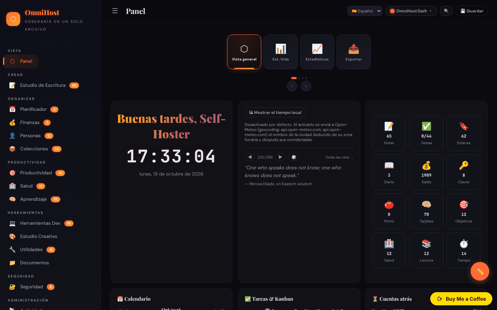

# OmniHost

[English](README.md) · [Română](README.ro.md) · [Français](README.fr.md) · [Italiano](README.it.md) · **Español** · [Português](README.pt.md) · [Deutsch](README.de.md) · [Magyar](README.hu.md)

**Versión:** 1.3.2 · **Última actualización:** 2026-10-22

Suite personal de productividad en un único archivo HTML («quine»): notas, planificador, finanzas, aprendizaje, herramientas y muchos módulos, inspirada en YunoHost.

**En línea:** https://chiuta.github.io/OmniHost/

## Qué es

OmniHost es un archivo `index.html` (~4 MB) que funciona como una aplicación personal completa, sin servidor y sin cuenta. Los datos se guardan en un objeto JSON dentro del archivo (`omnihost-store`); el botón «Save» descarga una copia de la aplicación con todos los datos incorporados. La interfaz muestra «141 Modules», y la descripción de la página lo llama «Single-File Sovereignty». La interfaz por defecto está en inglés.

## Funciones

Las barras laterales agrupan los módulos (con el número de elementos que muestra la aplicación):

- **Overview:** Dashboard (tarjeta con saludo, reloj, tiempo, cita, estadísticas rápidas, calendario, tareas / Kanban, cuenta atrás, actividad, «About OmniHost»), Life Stats, Stats, Export.
- **Create:** Writing Studio (Notes, Journal, Scratch, Blog, Meetings, Letters, Changelog, Knowledge, Citations, Editor, Prompts, Pipeline, Quotes).
- **Organize:** Planner (calendario, semana, año, rutinas, comidas, limpieza, sprint), Finance, People, Collections.
- **Productivity**, **Health**, **Learning** (incluidas las tarjetas / flashcards).
- **Tools:** Dev Toolkit, Creative Studio, Utilities (incluidos diccionario y traducción, generador y escáner de QR), Documents.
- **Secure:** Security (incluidas las claves). **Meta:** Activity, Settings.
- Cronologías (Universo, Galaxia, Sistema Solar, geológica, histórica, etc.) y wiki integrada con guías de los módulos, en Notes.
- 30 temas visuales y un «Custom Studio»; modo de edición del panel (reordenación arrastrando, cambio de tamaño).
- Interfaz en 71 idiomas, incluido el rumano.
- Conmutador rápido de módulos (`Ctrl/Cmd+K`).
- Exportación / importación JSON, restablecimiento a «Clean Quine», vista del código fuente y página «Licenses» (créditos de los componentes, incluidos jsQR y qrcodejs).

## Funciones nuevas (1.1.0)

- **Búsqueda en notas y diario** en el conmutador `Ctrl/Cmd+K`: bajo la lista de módulos aparece la sección «En notas y diario» (BM25, tolerancia a errores de escritura, diacríticos ignorados); un clic o Intro abre la nota o la entrada del diario.
- Copia de seguridad `.fff.json` (módulo común «fff-kit», local, sin red): se abre desde el diálogo que aparece al hacer clic en la versión del pie de página (exportación, exportación cifrada con contraseña, importación con confirmación, borrado de los datos de la aplicación). La copia incluye la base de datos de la aplicación (`omnihost_db`); al importar, la copia importada tiene prioridad sobre los datos del archivo. Una exportación marca la «última copia de seguridad».
- El diálogo del conmutador tiene ahora el rol dialog (accesibilidad). Los manejadores inline existentes no se modificaron.
- Los textos del selector y de la búsqueda en notas/diario (y los sufijos de los nombres accesibles generados automáticamente) existen en 8 idiomas (ro, en, fr, it, es, pt, de, hu; el idioma se toma de los ajustes de la aplicación); en los demás idiomas de la interfaz aparecen en inglés. Las traducciones fr/it/es/pt/de/hu son automáticas y **no han sido verificadas por un hablante nativo.**
- `fff.config.json` marca la aplicación como «automodificable» (el botón Save descarga una copia con los datos incorporados); el diálogo del kit advierte de que el hash de la copia guardada difiere.

## Manual de uso

1. Abre `index.html`. En el Dashboard, recorre las tareas de descubrimiento de la lista «Tasks».
2. Navega entre módulos desde la barra lateral (☰ en pantallas estrechas).
3. Cambia el idioma desde el selector de idioma de la barra superior o desde Settings.
4. Elige el tema con el botón «Theme» (30 temas) o desde «Custom Studio».
5. Añade contenido en los módulos (botón «+ Add»; las notas aceptan Markdown).
6. **Para conservar los datos:** pulsa «💾 Save» (o Settings → Save); se descarga un nuevo archivo HTML con todos los datos. Usa ese archivo a partir de entonces.
7. Copia de seguridad: Settings → «Export JSON»; restauración con la importación JSON en Settings.
8. Para restablecer la aplicación y elegir el idioma: Settings → «Clean Quine».
9. Las tarjetas del panel pueden reordenarse desde «✏️ Edit Mode» (luego «Done»).

## Privacidad y red

- **Almacenamiento:** el objeto de datos principal está en el archivo HTML; además, `localStorage` usa la clave `omnihost_db` (tras «Save» se reconstruye automáticamente, para que la copia `.fff.json` pueda incluirla). Si no la exportas cifrada, la copia `.fff.json` contiene en texto plano las contraseñas y los secretos de la aplicación: usa la exportación cifrada con contraseña.
- **Red:** el código contiene algunas llamadas a terceros, limitadas por la política CSP (`connect-src`) a cuatro hosts; todas salen solo tras una acción tuya:
  - `geocoding-api.open-meteo.com` y `api.open-meteo.com` — la tarjeta del tiempo del Dashboard está **DESACTIVADA por defecto**; al hacer clic en «Show local weather» (opt-in, recordado en los ajustes del archivo; se puede desactivar con «Turn weather off»), la ciudad deducida de la zona horaria del navegador se envía para la geocodificación, y luego las coordenadas para la previsión; los resultados se guardan en caché 30 minutos. Sin clic, al cargar no sale ninguna solicitud;
  - `api.dictionaryapi.dev` — solo cuando usas la búsqueda en el diccionario (la palabra buscada; eventualmente el sonido de pronunciación del mismo host);
  - `api.mymemory.translated.net` — solo cuando usas la traducción en Utilities (el texto a traducir).
- **Contraseñas y secretos:** los módulos Security/Passwords/TOTP guardan los datos como texto plano en el objeto JSON del archivo y en `localStorage` (`omnihost_db`); el módulo «Encrypt» es independiente. La protección en el navegador es solo cosmética (la nota aparece también en la página Passwords). Las entradas de ejemplo son credenciales de prueba públicas (las claves Stripe de la documentación se sustituyeron por un marcador de posición). No guardes aquí contraseñas importantes en un ordenador compartido y no distribuyas el archivo guardado.
- Los enlaces a otros sitios (p. ej. github.com, trade-free.org, apps.yunohost.org) solo se abren al hacer clic.
- Sin analítica, cuenta ni servidor propio.

## Advertencia

Herramienta personal de organización, con carácter informativo. Los módulos de los grupos «Health» y «Finance» (diario de síntomas, alergias, suplementos, calculadoras financieras, estimador de impuestos, etc.) no ofrecen consejo médico ni financiero y no sustituyen a un especialista. Las citas y los textos de ejemplo de la wiki son contenido de demostración y no se ha verificado su atribución.

## Ejecución local / sin conexión

Descarga `index.html` (y la carpeta `vendor/`, que contiene `jsQR.js` para el escáner de QR) y ábrelo en un navegador. Casi todos los módulos funcionan sin internet; el tiempo, el diccionario y la traducción necesitan conexión.

## Licencia

MIT — consulta el archivo LICENSE. La página «Licenses» de la aplicación, la cabecera del archivo y los textos de la wiki dicen lo mismo (MIT). Los componentes de terceros (p. ej. jsQR, qrcodejs) siguen bajo sus propias licencias, enumeradas en la página «Licenses».

## Auditoría

2026-10-10: verificado en el navegador (0 errores de JS; en esa fecha existía una solicitud automática a Open-Meteo, ahora eliminada). Corregido un XSS almacenado (los campos `priority` de las tareas y `module` del feed) que podía activarse mediante una importación JSON maliciosa, además de accesibilidad (nombres de controles, contraste, listas Markdown). Ronda 2 (2026-10-11): licencia unificada hacia CC0 (página «Licenses», wiki, flashcard); el tiempo en el Dashboard es ahora opt-in (ninguna solicitud automática al cargar); el texto estático «nothing is sent anywhere» de la tarjeta About se alineó con el de i18n; claves de prueba de Stripe sustituidas por un marcador de posición.

## Historial / Changelog

- 1.3.1 — 2026-10-19: el selector rápido de módulos (`Ctrl/Cmd+K`, el botón 🔍) con la búsqueda en notas y diario, los nombres accesibles automáticos para los controles sin etiqueta y los enganches de «última copia de seguridad» de la copia `.fff.json` (todos descritos arriba) están presentes en la versión actual: se habían eliminado por error en una limpieza anterior y se restauraron, con sus textos ahora en 8 idiomas. Corregido: los hashes de script añadidos a la CSP de la página junto a `'unsafe-inline'` hacían que el navegador bloqueara todos los manejadores en línea (`onclick=`, etc.); se quitaron los hashes y la CSP mantiene `script-src 'self' 'unsafe-inline' blob:` como antes.

- 1.1.0 — 2026-10-14: búsqueda aproximada en notas y diario con `Ctrl/Cmd+K` (FFF.search); copia `.fff.json` mediante los módulos comunes (core, label, bundle, search); nuevas pruebas: `tests/fff-r8.test.mjs`.

- 1.0.0 — 2026-10-12: la versión y la fecha de la última actualización se muestran en la aplicación (primera versión numerada; en la barra lateral, con una etiqueta traducida a los 71 idiomas).

**Ronda 7 — 11 de octubre de 2026**.
- Corregido: en pantallas estrechas, el banner de donaciones tapaba la nota del pie en la barra lateral abierta (la advertencia «Personal organizer, informational only…»); la barra lateral tiene ahora espacio abajo para el banner (y lo pierde si el banner se oculta).
- Verificado, no reproducido: el retraso del evento `load` sin conexión (en la prueba, `load` se dispara a ~0,9 s, con la red bloqueada).
- Sin cambios: los manejadores inline permanecen (el motivo de la Ronda 6 se mantiene).

**Ronda 6 — 11 de octubre de 2026**.
- Nuevo: conmutador rápido de módulos — `Ctrl/Cmd+K` o el botón 🔍 de la barra superior; busca entre los 141 módulos por nombre o grupo, navegación con ↑↓, Intro abre. La tecla `Esc` cierra ahora cualquier diálogo.
- Encrypt / Decrypt: estado visible (con `aria-live`) bajo el campo de salida para éxito/fallo, no solo un toast.
- La barra superior se parte en dos filas en pantallas estrechas (ya no corta los botones); el contenido tiene espacio abajo para el botón de donaciones.
- Sin cambios: los manejadores inline (~1400) permanecen — el archivo se guarda como «quine» mediante `outerHTML`, y el «minify» reescribe el script, por lo que una CSP por hash invalidaría los archivos guardados.

**Ronda 5 — 11 de octubre de 2026**.
- El descifrado con contraseña incorrecta vacía ahora el campo de salida (ya no queda el texto antiguo).
- El mensaje de donaciones ya no tapa el botón de edición del panel (el botón se subió; el contenido tiene espacio abajo); el mensaje es un punto de referencia `complementary`.
- Accesibilidad: nombre para el selector de idioma, orden correcto de los títulos en el calendario; axe-core = 0 infracciones a 1280 y 360 px.
- Sin cambios: los 1377 manejadores inline (`onclick=`, etc.) permanecen; la calidad de las traducciones a los 71 idiomas no es verificable.

## Autor

Alexio — Alexandru-Ionuț Chiuță. Contacto: alexio@trom.tf

## Resumen

OmniHost es una suite personal de productividad «quine» de un solo archivo (notas, planificador, finanzas, aprendizaje, herramientas, seguridad y más; 30 temas; interfaz en 71 idiomas). Los datos viven dentro del archivo HTML y en localStorage (`omnihost_db`); «Save» descarga una copia con los datos incorporados. El uso de la red se limita a Open-Meteo (tiempo del panel, opt-in), dictionaryapi.dev (diccionario) y MyMemory (traducción). Licencia MIT.

### 1.3.2 — 2026-10-22
- El aviso de la barra lateral se muestra ahora en un solo idioma, y las tareas de bienvenida, el flujo de actividad de demostración y algunas descripciones y etiquetas están traducidos a los idiomas de la interfaz (los textos de las citas y el resto de datos de demostración se mantienen como están).

