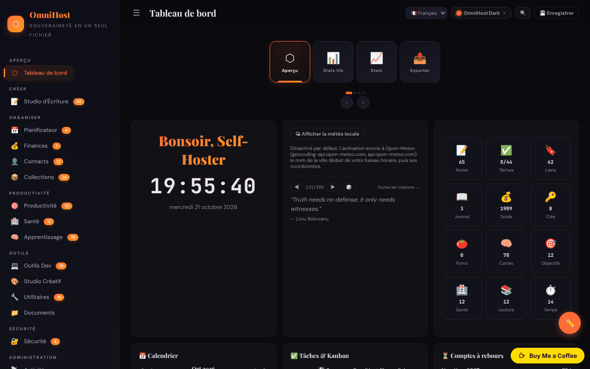

# OmniHost

[English](README.md) · [Română](README.ro.md) · **Français** · [Italiano](README.it.md) · [Español](README.es.md) · [Português](README.pt.md) · [Deutsch](README.de.md) · [Magyar](README.hu.md)

**Version :** 1.3.2 · **Dernière mise à jour :** 2026-10-22

Suite personnelle de productivité dans un seul fichier HTML (« quine ») : notes, planificateur, finances, apprentissage, outils et de nombreux modules, inspirée de YunoHost.

**En ligne :** https://chiuta.github.io/OmniHost/

## Ce que c'est

OmniHost est un fichier `index.html` (~4 Mo) qui fonctionne comme une application personnelle complète, sans serveur et sans compte. Les données sont conservées dans un objet JSON à l'intérieur du fichier (`omnihost-store`) ; le bouton « Save » télécharge une copie de l'application avec toutes les données intégrées. L'interface affiche « 141 Modules », et la description de la page l'appelle « Single-File Sovereignty ». L'interface par défaut est en anglais.

## Fonctionnalités

Les barres latérales regroupent les modules (avec le nombre d'éléments affiché dans l'application) :

- **Overview :** Dashboard (carte avec salutation, horloge, météo, citation, statistiques rapides, calendrier, tâches / Kanban, compte à rebours, activité, « About OmniHost »), Life Stats, Stats, Export.
- **Create :** Writing Studio (Notes, Journal, Scratch, Blog, Meetings, Letters, Changelog, Knowledge, Citations, Editor, Prompts, Pipeline, Quotes).
- **Organize :** Planner (calendrier, semaine, année, routines, repas, ménage, sprint), Finance, People, Collections.
- **Productivity**, **Health**, **Learning** (y compris les cartes mémoire / flashcards).
- **Tools :** Dev Toolkit, Creative Studio, Utilities (y compris dictionnaire et traduction, générateur et lecteur de QR), Documents.
- **Secure :** Security (y compris les clés). **Meta :** Activity, Settings.
- Chronologies (Univers, Galaxie, Système solaire, géologique, historique, etc.) et wiki intégré avec des guides pour les modules, dans Notes.
- 30 thèmes visuels et un « Custom Studio » ; mode d'édition du tableau de bord (réorganisation par glisser-déposer, redimensionnement).
- Interface en 71 langues, dont le roumain.
- Sélecteur rapide de modules (`Ctrl/Cmd+K`).
- Export / import JSON, réinitialisation à « Clean Quine », affichage de la source et page « Licenses » (crédits des composants, dont jsQR et qrcodejs).

## Nouvelles fonctionnalités (1.1.0)

- **Recherche dans les notes et le journal** dans le sélecteur `Ctrl/Cmd+K` : sous la liste des modules apparaît la section « Dans les notes et le journal » (BM25, tolérance aux fautes de frappe, diacritiques ignorés) ; un clic ou Entrée ouvre la note ou l'entrée du journal.
- Sauvegarde `.fff.json` (module commun « fff-kit », local, sans réseau) : elle s'ouvre depuis la boîte de dialogue qui apparaît au clic sur la version dans le pied de page (export, export chiffré par mot de passe, import avec confirmation, suppression des données de l'application). La sauvegarde comprend la base de données de l'application (`omnihost_db`) ; à l'import, la copie importée a priorité sur les données du fichier. Un export marque la « dernière sauvegarde ».
- La boîte de dialogue du sélecteur a désormais le rôle dialog (accessibilité). Les gestionnaires inline existants n'ont pas été modifiés.
- Les textes du sélecteur et de la recherche dans les notes/le journal (et les suffixes des noms accessibles générés automatiquement) existent en 8 langues (ro, en, fr, it, es, pt, de, hu ; la langue est prise dans les réglages de l'application) ; dans les autres langues de l'interface, ils apparaissent en anglais. Les traductions fr/it/es/pt/de/hu sont automatiques et **n'ont pas été vérifiées par un locuteur natif.**
- `fff.config.json` marque l'application comme « auto-modifiable » (le bouton Save télécharge une copie avec les données intégrées) ; la boîte de dialogue du kit avertit que le hachage de la copie enregistrée diffère.

## Mode d'emploi

1. Ouvrez `index.html`. Sur le Dashboard, parcourez les tâches de découverte de la liste « Tasks ».
2. Naviguez entre les modules depuis la barre latérale (☰ sur les écrans étroits).
3. Changez la langue depuis le sélecteur de langue de la barre supérieure ou depuis Settings.
4. Choisissez le thème avec le bouton « Theme » (30 thèmes) ou depuis « Custom Studio ».
5. Ajoutez du contenu dans les modules (bouton « + Add » ; les notes acceptent le Markdown).
6. **Pour conserver vos données :** appuyez sur « 💾 Save » (ou Settings → Save) ; un nouveau fichier HTML contenant toutes les données est téléchargé. Utilisez désormais ce fichier.
7. Sauvegarde : Settings → « Export JSON » ; restauration avec l'import JSON dans Settings.
8. Pour réinitialiser l'application et choisir la langue : Settings → « Clean Quine ».
9. Les cartes du tableau de bord peuvent être réorganisées depuis « ✏️ Edit Mode » (puis « Done »).

## Confidentialité et réseau

- **Stockage :** l'objet de données principal se trouve dans le fichier HTML ; en plus, `localStorage` utilise la clé `omnihost_db` (après « Save », elle est reconstituée automatiquement, afin que la copie `.fff.json` puisse l'inclure). Sauf si vous l'exportez chiffrée, la copie `.fff.json` contient en clair les mots de passe et les secrets de l'application : utilisez l'export chiffré par mot de passe.
- **Réseau :** le code contient quelques appels vers des tiers, limités par la politique CSP (`connect-src`) à quatre hôtes ; tous ne partent qu'après une action de votre part :
  - `geocoding-api.open-meteo.com` et `api.open-meteo.com` — la carte météo du Dashboard est **DÉSACTIVÉE par défaut** ; au clic sur « Show local weather » (opt-in, mémorisé dans les réglages du fichier ; peut être désactivé avec « Turn weather off »), la ville déduite du fuseau horaire du navigateur est envoyée pour le géocodage, puis les coordonnées pour la prévision ; les résultats sont mis en cache 30 minutes. Sans clic, aucune requête ne part au chargement ;
  - `api.dictionaryapi.dev` — uniquement quand vous utilisez la recherche dans le dictionnaire (le mot recherché ; éventuellement le son de prononciation provenant du même hôte) ;
  - `api.mymemory.translated.net` — uniquement quand vous utilisez la traduction dans Utilities (le texte à traduire).
- **Mots de passe et secrets :** les modules Security/Passwords/TOTP conservent les données en clair dans l'objet JSON du fichier et dans `localStorage` (`omnihost_db`) ; le module « Encrypt » est distinct. La protection dans le navigateur n'est que cosmétique (la note apparaît aussi sur la page Passwords). Les entrées d'exemple sont des identifiants de test publics (les clés Stripe de la documentation ont été remplacées par un espace réservé). Ne stockez pas ici de mots de passe importants sur un ordinateur partagé et ne distribuez pas le fichier enregistré.
- Les liens vers d'autres sites (p. ex. github.com, trade-free.org, apps.yunohost.org) ne s'ouvrent qu'au clic.
- Pas d'analyse d'audience, de compte ni de serveur propre.

## Avertissement

Outil personnel d'organisation, à titre informatif. Les modules des groupes « Health » et « Finance » (journal de symptômes, allergies, compléments, calculateurs financiers, estimateur d'impôts, etc.) ne donnent pas de conseils médicaux ou financiers et ne remplacent pas un spécialiste. Les citations et textes d'exemple du wiki sont du contenu de démonstration et n'ont pas été vérifiés quant à leur attribution.

## Exécution locale / hors ligne

Téléchargez `index.html` (et le dossier `vendor/`, qui contient `jsQR.js` pour le lecteur de QR) et ouvrez-le dans un navigateur. Presque tous les modules fonctionnent sans internet ; la météo, le dictionnaire et la traduction nécessitent une connexion.

## Licence

MIT — voir le fichier LICENSE. La page « Licenses » de l'application, l'en-tête du fichier et les textes du wiki disent la même chose (MIT). Les composants tiers (p. ex. jsQR, qrcodejs) restent sous leurs propres licences, listées sur la page « Licenses ».

## Audit

2026-10-10 : vérifié dans le navigateur (0 erreur JS ; à cette date il existait une requête automatique vers Open-Meteo, désormais supprimée). Correction d'une XSS stockée (les champs `priority` des tâches et `module` du flux) qui pouvait être déclenchée par un import JSON malveillant, ainsi que l'accessibilité (noms des contrôles, contraste, listes Markdown). Tour 2 (2026-10-11) : licence unifiée vers CC0 (page « Licenses », wiki, flashcard) ; la météo du Dashboard est désormais en opt-in (aucune requête automatique au chargement) ; le texte statique « nothing is sent anywhere » de la carte About a été aligné sur celui de l'i18n ; clés de test Stripe remplacées par un espace réservé.

## Historique / Changelog

- 1.3.1 — 2026-10-19 : le sélecteur rapide de modules (`Ctrl/Cmd+K`, le bouton 🔍) avec la recherche dans les notes et le journal, les noms accessibles automatiques pour les contrôles sans étiquette et les crochets « dernière sauvegarde » de la copie `.fff.json` (tous décrits ci-dessus) sont présents dans la version actuelle : ils avaient été supprimés par erreur lors d'un nettoyage antérieur et ont été restaurés, leurs textes étant désormais en 8 langues. Corrigé : des empreintes de script ajoutées à la CSP de la page à côté de `'unsafe-inline'` faisaient bloquer par le navigateur tous les gestionnaires en ligne (`onclick=` etc.) ; les empreintes ont été retirées et la CSP garde `script-src 'self' 'unsafe-inline' blob:` comme avant.

- 1.1.0 — 2026-10-14 : recherche approximative dans les notes et le journal avec `Ctrl/Cmd+K` (FFF.search) ; copie `.fff.json` via les modules communs (core, label, bundle, search) ; nouveaux tests : `tests/fff-r8.test.mjs`.

- 1.0.0 — 2026-10-12 : la version et la date de la dernière mise à jour sont affichées dans l'application (première version numérotée ; dans la barre latérale, avec une étiquette traduite dans les 71 langues).

**Tour 7 — 11 octobre 2026**.
- Corrigé : sur les écrans étroits, la bannière de dons recouvrait la note de pied de page de la barre latérale ouverte (l'avertissement « Personal organizer, informational only… ») ; la barre latérale dispose désormais d'un espace en bas pour la bannière (et le perd si la bannière est masquée).
- Vérifié, non reproduit : le retard de l'événement `load` hors ligne (dans le test, `load` se déclenche à ~0,9 s, réseau bloqué).
- Inchangé : les gestionnaires inline restent (la raison du Tour 6 est maintenue).

**Tour 6 — 11 octobre 2026**.
- Nouveau : sélecteur rapide de modules — `Ctrl/Cmd+K` ou le bouton 🔍 de la barre supérieure ; il cherche parmi les 141 modules par nom ou par groupe, navigation avec ↑↓, Entrée ouvre. La touche `Esc` ferme désormais toute boîte de dialogue.
- Encrypt / Decrypt : état visible (avec `aria-live`) sous le champ de sortie pour le succès/l'échec, et non plus seulement un toast.
- La barre supérieure se répartit sur deux lignes sur les écrans étroits (elle ne coupe plus les boutons) ; le contenu dispose d'un espace en bas pour le bouton de dons.
- Inchangé : les gestionnaires inline (~1400) restent — le fichier est enregistré comme « quine » via `outerHTML`, et le « minify » réécrit le script, donc une CSP par hachage invaliderait les fichiers enregistrés.

**Tour 5 — 11 octobre 2026**.
- Le déchiffrement avec un mauvais mot de passe vide désormais le champ de sortie (l'ancien texte ne reste plus).
- Le message de dons ne recouvre plus le bouton d'édition du tableau de bord (le bouton a été remonté ; le contenu dispose d'un espace en bas) ; le message est un repère `complementary`.
- Accessibilité : nom pour le sélecteur de langue, ordre correct des titres dans le calendrier ; axe-core = 0 violation à 1280 et 360 px.
- Inchangé : les 1377 gestionnaires inline (`onclick=`, etc.) restent ; la qualité des traductions dans les 71 langues n'est pas vérifiable.

## Auteur

Alexio — Alexandru-Ionuț Chiuță. Contact : alexio@trom.tf

## Résumé

OmniHost est une suite personnelle de productivité « quine » monofichier (notes, planificateur, finances, apprentissage, outils, sécurité et plus encore ; 30 thèmes ; interface en 71 langues). Les données résident dans le fichier HTML et dans localStorage (`omnihost_db`) ; « Save » télécharge une copie avec les données intégrées. L'usage du réseau se limite à Open-Meteo (météo du tableau de bord, opt-in), dictionaryapi.dev (dictionnaire) et MyMemory (traduction). Licence MIT.

### 1.3.2 — 2026-10-22
- L'avertissement de la barre latérale s'affiche désormais dans une seule langue, et les tâches de bienvenue, le fil d'activité de démonstration ainsi que quelques info-bulles et libellés sont traduits dans les langues de l'interface (les citations et les autres données de démonstration restent telles quelles).

