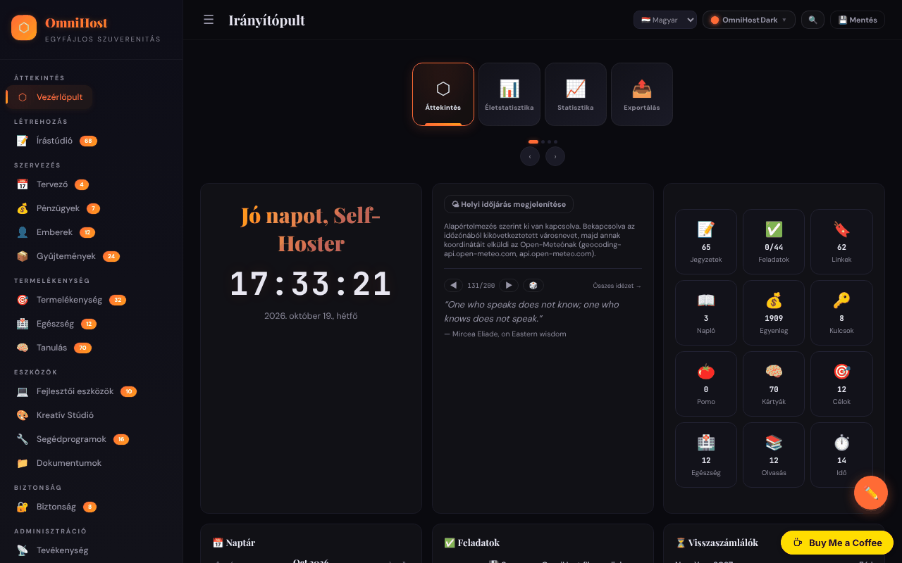

# OmniHost

[English](README.md) · [Română](README.ro.md) · [Français](README.fr.md) · [Italiano](README.it.md) · [Español](README.es.md) · [Português](README.pt.md) · [Deutsch](README.de.md) · **Magyar**

**Verzió:** 1.3.10 · **Utolsó frissítés:** 2026-10-23

Személyes termelékenységi csomag egyetlen HTML-fájlban („quine”): jegyzetek, tervező, pénzügyek, tanulás, eszközök és sok modul, a YunoHost ihletésével.

**Élő verzió:** https://chiuta.github.io/OmniHost/

## Mi ez

Az OmniHost egy `index.html` fájl (~4 MB), amely teljes értékű személyes alkalmazásként működik, szerver és fiók nélkül. Az adatok a fájlon belül egy JSON-objektumban tárolódnak (`omnihost-store`); a „Save” gomb letölti az alkalmazás egy másolatát az összes beágyazott adattal. A felület a „141 Modules” feliratot mutatja, az oldalon lévő leírás pedig „Single-File Sovereignty”-nek nevezi. Az alapértelmezett felület angol nyelvű.

## Funkciók

Az oldalsávok csoportosítják a modulokat (az alkalmazásban megjelenített elemszámmal):

- **Overview:** Dashboard (kártya üdvözléssel, órával, időjárással, idézettel, gyors statisztikákkal, naptárral, feladatokkal / Kanbannal, visszaszámlálással, tevékenységgel, „About OmniHost”), Life Stats, Stats, Export.
- **Create:** Writing Studio (Notes, Journal, Scratch, Blog, Meetings, Letters, Changelog, Knowledge, Citations, Editor, Prompts, Pipeline, Quotes).
- **Organize:** Planner (naptár, hét, év, rutinok, étkezések, takarítás, sprint), Finance, People, Collections.
- **Productivity**, **Health**, **Learning** (a tanulókártyákat / flashcardokat is beleértve).
- **Tools:** Dev Toolkit, Creative Studio, Utilities (szótárral és fordítóval, QR-generátorral és -olvasóval), Documents.
- **Secure:** Security (a kulcsokat is beleértve). **Meta:** Activity, Settings.
- Idővonalak (Univerzum, Galaxis, Naprendszer, földtani, történelmi stb.) és beépített wiki a modulok útmutatóival, a Notes-ban.
- 30 vizuális téma és egy „Custom Studio”; a műszerfal szerkesztési módja (átrendezés húzással, átméretezés).
- Felület 71 nyelven, a románt is beleértve.
- Gyors modulváltó (`Ctrl/Cmd+K`).
- JSON-export / -import, visszaállítás „Clean Quine” állapotra, forrásnézet és „Licenses” oldal (a komponensek köszönetnyilvánításai, köztük a jsQR és a qrcodejs).

## Új funkciók (1.1.0)

- **Keresés a jegyzetekben és a naplóban** a `Ctrl/Cmd+K` váltóban: a modullista alatt megjelenik a „Jegyzetekben és naplóban” szakasz (BM25, elgépelés-tűrés, ékezetek figyelmen kívül hagyva); kattintásra vagy Enterre megnyílik a jegyzet vagy a naplóbejegyzés.
- `.fff.json` biztonsági mentés (közös „fff-kit” modul, helyi, hálózat nélkül): a láblécben a verzióra kattintva megjelenő párbeszédablakból nyílik meg (export, jelszóval titkosított export, megerősítéssel végzett import, az alkalmazás adatainak törlése). A mentés tartalmazza az alkalmazás adatbázisát (`omnihost_db`); importáláskor az importált másolat elsőbbséget élvez a fájlban lévő adatokkal szemben. Egy export megjelöli az „utolsó biztonsági mentést”.
- A váltó párbeszédablaka most dialog szerepet kapott (akadálymentesség). A meglévő inline eseménykezelők nem módosultak.
- A váltó és a jegyzet-/naplókeresés szövegei (és az automatikusan generált hozzáférhető nevek utótagjai) 8 nyelven léteznek (ro, en, fr, it, es, pt, de, hu; a nyelvet az alkalmazás beállításaiból veszi); a felület többi nyelvén angolul jelennek meg. Az fr/it/es/pt/de/hu fordítások gépiek, és **anyanyelvi beszélő nem ellenőrizte őket.**
- Az `fff.config.json` az alkalmazást „önmódosítóként” jelöli meg (a Save gomb letölt egy másolatot a beágyazott adatokkal); a készlet párbeszédablaka figyelmeztet, hogy a mentett másolat hash-e eltér.

## Használati útmutató

1. Nyisd meg az `index.html` fájlt. A Dashboardon végigmehetsz a „Tasks” lista felfedező feladatain.
2. Az oldalsávból navigálj a modulok között (☰ keskeny képernyőkön).
3. A nyelvet a felső sáv nyelvválasztójából vagy a Settingsből válthatod.
4. A témát a „Theme” gombbal (30 téma) vagy a „Custom Studio”-ból választhatod ki.
5. Adj hozzá tartalmat a modulokban („+ Add” gomb; a jegyzetek elfogadják a Markdownt).
6. **Az adataid megőrzéséhez:** nyomd meg a „💾 Save” gombot (vagy Settings → Save); letöltődik egy új HTML-fájl az összes adattal. Mostantól azt a fájlt használd.
7. Biztonsági mentés: Settings → „Export JSON”; visszaállítás a Settingsben a JSON-importtal.
8. Az alkalmazás visszaállításához és a nyelv kiválasztásához: Settings → „Clean Quine”.
9. A műszerfal kártyái az „✏️ Edit Mode” menüben rendezhetők át (majd „Done”).

## Adatvédelem és hálózat

- **Tárolás:** a fő adatobjektum a HTML-fájlban van; emellett a `localStorage` az `omnihost_db` kulcsot használja (a „Save” után automatikusan újraépül, hogy a `.fff.json` másolat tartalmazhassa). Ha nem titkosítva exportálod, a `.fff.json` másolat egyszerű szövegként tartalmazza az alkalmazás jelszavait és titkait: használd a jelszóval titkosított exportot.
- **Hálózat:** a kód néhány harmadik félnek szóló hívást tartalmaz, amelyeket a CSP-szabályzat (`connect-src`) négy hosztra korlátoz; mindegyik csak egy műveleted után indul el:
  - `geocoding-api.open-meteo.com` és `api.open-meteo.com` — a Dashboard időjárás-kártyája **alapértelmezetten KI van kapcsolva**; a „Show local weather” gombra kattintva (opt-in, a fájlban lévő beállításokban megjegyezve; a „Turn weather off” gombbal kikapcsolható) a böngésző időzónájából kikövetkeztetett várost elküldi geokódolásra, majd a koordinátákat az előrejelzéshez; az eredményeket 30 percig gyorsítótárazza. Kattintás nélkül betöltéskor semmilyen kérés nem megy ki;
  - `api.dictionaryapi.dev` — csak akkor, ha a szótárkeresést használod (a keresett szó; esetleg a kiejtés hangja ugyanarról a hosztról);
  - `api.mymemory.translated.net` — csak akkor, ha az Utilities fordítóját használod (a lefordítandó szöveg).
- **Jelszavak és titkok:** a Security/Passwords/TOTP modulok az adatokat egyszerű szövegként tárolják a fájlban lévő JSON-objektumban és a `localStorage`-ban (`omnihost_db`); az „Encrypt” modul különálló. A böngészőben nyújtott védelem csak kozmetikai (a megjegyzés a Passwords oldalon is megjelenik). A példabejegyzések nyilvános tesztbejelentkezési adatok (a dokumentációból származó Stripe-kulcsokat helyőrzőre cseréltük). Ne tárolj itt fontos jelszavakat megosztott számítógépen, és ne terjeszd a mentett fájlt.
- A más webhelyekre mutató hivatkozások (pl. github.com, trade-free.org, apps.yunohost.org) csak kattintásra nyílnak meg.
- Nincs analitika, fiók vagy saját szerver.

## Figyelmeztetés

Személyes szervezőeszköz, tájékoztató jelleggel. A „Health” és „Finance” csoportok moduljai (tünetnapló, allergiák, étrend-kiegészítők, pénzügyi kalkulátorok, adóbecslő stb.) nem adnak orvosi vagy pénzügyi tanácsot, és nem helyettesítenek szakembert. A wikiben szereplő idézetek és mintaszövegek bemutató tartalmak, tulajdonításukat nem ellenőriztük.

## Helyi futtatás / offline

Töltsd le az `index.html` fájlt (és a `vendor/` mappát, amely a QR-olvasóhoz szükséges `jsQR.js` fájlt tartalmazza), és nyisd meg böngészőben. Szinte minden modul internet nélkül működik; az időjárás, a szótár és a fordítás kapcsolatot igényel.

## Licenc

MIT — lásd a LICENSE fájlt. Az alkalmazás „Licenses” oldala, a fájl fejléce és a wiki szövegei ugyanezt mondják (MIT). A harmadik felek komponensei (pl. jsQR, qrcodejs) a saját licencük alatt maradnak, amelyeket a „Licenses” oldal sorol fel. NOTICE: a beágyazott külső komponensek teljes listája (jsQR 1.4.0 Apache-2.0; a JetBrains Mono, DM Sans, Playfair Display betűtípusok SIL OFL 1.1 alatt; a Trade-Free logó; online szolgáltatások) verziókkal és szerzői jogi adatokkal a [NOTICE.md](NOTICE.md) fájlban van.

## Audit

2026-10-10: böngészőben ellenőrizve (0 JS-hiba; az adott időpontban volt egy automatikus kérés az Open-Meteo felé, ez azóta megszűnt). Javítottunk egy tárolt XSS-t (a feladatok `priority` és a hírfolyam `module` mezői), amelyet egy rosszindulatú JSON-importtal ki lehetett váltani, valamint az akadálymentességet (a vezérlők nevei, kontraszt, Markdown-listák). 2. kör (2026-10-11): a licenc egységesítve CC0 felé („Licenses” oldal, wiki, flashcard); a Dashboard időjárása mostantól opt-in (betöltéskor nincs automatikus kérés); az About kártya „nothing is sent anywhere” statikus szövegét összehangoltuk az i18n-ben lévővel; a Stripe-tesztkulcsok helyőrzőre cserélve.

## Előzmények / Changelog

### 1.3.9 — 2026-10-22

Biztonság: nincs több inline eseménykezelő, szigorú CSP, opcionális mesterjelszó.

- **Eseménydelegálás:** mind az 1 395 inline eseménykezelő (`onclick=`, `onchange=`, `oninput=` stb., a statikus HTML-ben és a JS-sablonokban) helyére `data-act` / `data-a1…` attribútumok és egyetlen, a `document`-en lévő elosztó került, amely egy engedélyezett műveleti táblázat függvényeit hívja (455 művelet). A viselkedés változatlan (automatikus egyenértékűségi olvasóval ellenőrizve: az 1 191 különböző helyből 1 190 azonos; az egyetlen eltérés a véletlen jelszógenerátor).
- **Szigorú CSP:** a `'unsafe-inline'` kikerült a `script-src`-ből (csak `'self' blob:` és a valódi inline szkriptek sha256-hash-ei); a kivétel törölve az `fff.config.json`-ból; a `fixcsp`, az `info` és a szigorú `check` kivétel nélkül átmegy. A „Save Minified” már nem írja át a szkripteket (érvénytelenítené a hash-eket). A `style-src` még engedi a `'unsafe-inline'`-t.
- **Opcionális mesterjelszó** (Beállítások): AES-256-GCM-mel, 600 000 iterációs PBKDF2-SHA256-tal titkosítja az érzékeny mezőket (jelszavak, 2FA-kulcsok, széf-bejegyzések), mezőnként külön sóval/IV-vel; a modul első elérésekor kéri, csak a memóriában tartja a munkamenet alatt (15 perc tétlenség után automatikus zárolás); módosítás, kikapcsolás, átállás nyílt szövegről; üzenetek 8 nyelven. A `.fff.json` másolat titkosítva tartja ezeket a mezőket. Nincs visszaállítás: az elveszett mesterjelszót csak a védett adatok törlésével lehet alaphelyzetbe állítani.
- A natív `confirm`/`prompt` ablakokat az oldalba ágyazott párbeszédek váltották (közös `dialog` modul); a felület fordításai kiegészítve (i18n-paritás).
- Új `NOTICE.md` (külső komponensek). Javítva: a Scratchpad letöltése tévesen a `document.URL`-t használta.
- Tesztek: `tests/master-pw.test.mjs` (új), frissített/sikeres `audit-r10`, `fff-r8` és `restore-r6`.

### 1.3.8 — 2026-10-22

fff-kit 1.1.4: érintési célok és minimális szövegméret; érintési célok és szöveg javítva.

- 1.3.7 — 2026-10-22: biztonság. Az adatokat (localStorage, a fájlba ágyazott másolat és minden importált JSON vagy `.fff.json` mentés) mostantól sémával ellenőrzi az alkalmazás: az azonosítóknak meg kell felelniük a `^[A-Za-z0-9_-]{1,64}$` mintának, a típusokat és méreteket ellenőrzi, a veszélyes kulcsokat (`__proto__` …) és szövegeket kijavítja vagy eltávolítja, 8 nyelvű üzenettel. Minden, az adatokból származó és soron belüli eseménykezelőbe vagy sablonba kerülő érték escape-elve van (`jsa()`/`esc()`), így egy ellenséges mentés nem tud kódot futtatni, és a `localStorage.omnihost_db` tartalmát sem olvashatja. A kit titkosítatlan `.fff.json` mentése már nem tartalmaz jelszavakat, 2FA-kulcsokat és széfbejegyzéseket (a jelszóval készült mentés teljes és titkosított marad); a Beállításokban egy megjegyzés ezt magyarázza. Nincs kész: a CSP-ben még van `'unsafe-inline'` (mintegy 1390 soron belüli eseménykezelő maradt; az `addEventListener`-re való átállás nagyobb átalakítás). Új teszt: `tests/audit-r10.test.mjs`.
- 1.3.6 — 2026-10-22: fff-kit 1.1.2: PBKDF2 600 000 iterációval, clickjacking elleni védelem
- 1.3.1 — 2026-10-19: a gyors modulváltó (`Ctrl/Cmd+K`, a 🔍 gomb) a jegyzetek és a napló közti kereséssel, a címke nélküli vezérlők automatikus hozzáférhető nevei és a `.fff.json` másolat „utolsó mentés” kapcsai (mind fentebb leírva) megvannak a jelenlegi verzióban: egy korábbi takarításkor tévedésből eltávolították őket, és helyreállítottuk őket, szövegeik most 8 nyelven vannak. Javítva: az oldal CSP-jébe a `'unsafe-inline'` mellé került szkript-hash-ek miatt a böngésző minden beágyazott kezelőt (`onclick=` stb.) letiltott; a hash-eket eltávolítottuk, és a CSP a korábbiak szerint `script-src 'self' 'unsafe-inline' blob:` marad.

- 1.1.0 — 2026-10-14: hozzávetőleges keresés a jegyzetekben és a naplóban a `Ctrl/Cmd+K` segítségével (FFF.search); `.fff.json` másolat a közös modulokon keresztül (core, label, bundle, search); új tesztek: `tests/fff-r8.test.mjs`.

- 1.0.0 — 2026-10-12: a verzió és az utolsó frissítés dátuma megjelenik az alkalmazásban (az első számozott verzió; az oldalsávban, a 71 nyelvre lefordított felirattal).

**7. kör — 2026. október 11.**.
- Javítva: keskeny képernyőkön az adománysáv eltakarta a lábjegyzetet a megnyitott oldalsávban (a „Personal organizer, informational only…” figyelmeztetést); az oldalsávban most van hely alul a sávnak (és elveszíti, ha a sáv el van rejtve).
- Ellenőrizve, nem reprodukálható: a `load` esemény késése offline (a tesztben a `load` ~0,9 s-nál váltódik ki, letiltott hálózat mellett).
- Változatlan: az inline eseménykezelők maradnak (a 6. kör indoka továbbra is fennáll).

**6. kör — 2026. október 11.**.
- Új: gyors modulváltó — `Ctrl/Cmd+K` vagy a felső sáv 🔍 gombja; a 141 modul között keres név vagy csoport szerint, navigáció ↑↓ gombokkal, az Enter megnyit. Az `Esc` billentyű mostantól bármely párbeszédablakot bezár.
- Encrypt / Decrypt: látható állapot (`aria-live` attribútummal) a kimeneti mező alatt a sikerhez/kudarchoz, nem csak egy toast.
- A felső sáv keskeny képernyőkön két sorba tör (már nem vágja le a gombokat); a tartalomnak van helye alul az adománygombnak.
- Változatlan: az inline eseménykezelők (~1400) maradnak — a fájl „quine”-ként, `outerHTML`-en keresztül mentődik, a „minify” pedig átírja a szkriptet, így a hash alapú CSP érvénytelenítené a mentett fájlokat.

**5. kör — 2026. október 11.**.
- A hibás jelszóval végzett visszafejtés most kiüríti a kimeneti mezőt (a régi szöveg nem marad meg).
- Az adományüzenet már nem takarja el a műszerfal szerkesztés gombját (a gomb feljebb került; a tartalomnak van helye alul); az üzenet `complementary` támpont.
- Akadálymentesség: név a nyelvválasztónak, helyes címsorrend a naptárban; axe-core = 0 szabálysértés 1280 és 360 px szélességen.
- Változatlan: az 1377 inline eseménykezelő (`onclick=` stb.) marad; a 71 nyelvre készült fordítások minősége nem ellenőrizhető.

## Szerző

Alexio — Alexandru-Ionuț Chiuță. Kapcsolat: alexio@trom.tf

## Összefoglaló

Az OmniHost egy egyfájlos „quine” személyes termelékenységi csomag (jegyzetek, tervező, pénzügyek, tanulás, eszközök, biztonság és még sok más; 30 téma; felület 71 nyelven). Az adatok a HTML-fájlban és a localStorage-ban (`omnihost_db`) élnek; a „Save” letölti a beágyazott adatokat tartalmazó másolatot. A hálózathasználat az Open-Meteóra (műszerfal-időjárás, opt-in), a dictionaryapi.dev-re (szótár) és a MyMemoryra (fordítás) korlátozódik. MIT licenc.

### 1.3.5 — 2026-10-22
- Hozzáférhetőség és mobil: oldalanként egyetlen H1 (a Markdown-címsorok H2-vé válnak), legalább 12 px-es szövegek és legalább 24 px-es érintési célok.

### 1.3.4 — 2026-10-22
- A többi nyelven angolul maradt feliratok és szövegek le vannak fordítva (modulleírások, biztonsági ellenőrzőlista, HTTP-referencia, naptári hónapnevek, kategóriák és állapotok, gyakorlatok és étkezések, profilszöveg), a Fordító és a Szótár nyelvválasztóinak akadálymentes neve pedig követi a felület nyelvét. A tulajdonnevek, idézetek, kód és azonosítók változatlanok.

### 1.3.3 — 2026-10-22
- A modulok dokumentációja (útmutatók és bemutatók) mind a 8 nyelvre le van fordítva, az üdvözlő tartalom (feladatok, napló, névjegyek, célok, receptek, tanulókártyák és egyéb demóadatok) pedig követi a felület nyelvét, később váltáskor is. A te szerkesztéseidet nem érinti; néhány modulfelirat is lefordult (az idézetek megtartják eredeti nyelvüket és a forrásmegjelölést).

### 1.3.2 — 2026-10-22
- Az oldalsáv figyelmeztetése most egyetlen nyelven jelenik meg, az üdvözlő feladatok, a demó tevékenységfolyam, valamint néhány súgószöveg és felirat le van fordítva a felület nyelveire (az idézetek szövege és a többi demóadat változatlan marad).

