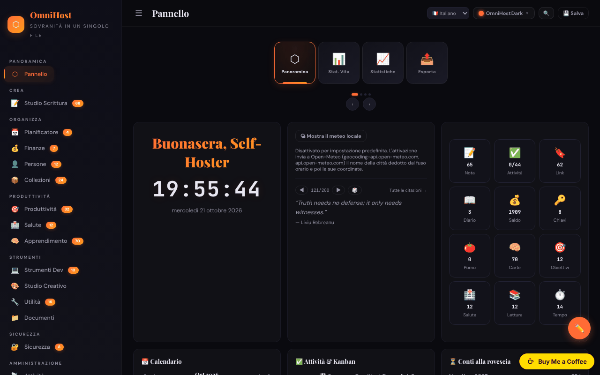

# OmniHost

[English](README.md) · [Română](README.ro.md) · [Français](README.fr.md) · **Italiano** · [Español](README.es.md) · [Português](README.pt.md) · [Deutsch](README.de.md) · [Magyar](README.hu.md)

**Versione:** 1.3.3 · **Ultimo aggiornamento:** 2026-10-22

Suite personale di produttività in un unico file HTML («quine»): note, pianificatore, finanze, apprendimento, strumenti e molti moduli, ispirata a YunoHost.

**Online:** https://chiuta.github.io/OmniHost/

## Che cos'è

OmniHost è un file `index.html` (~4 MB) che funziona come un'applicazione personale completa, senza server e senza account. I dati sono conservati in un oggetto JSON all'interno del file (`omnihost-store`); il pulsante «Save» scarica una copia dell'applicazione con tutti i dati incorporati. L'interfaccia mostra «141 Modules», e la descrizione nella pagina lo chiama «Single-File Sovereignty». L'interfaccia predefinita è in inglese.

## Funzioni

Le barre laterali raggruppano i moduli (con il numero di elementi mostrato nell'app):

- **Overview:** Dashboard (scheda con saluto, orologio, meteo, citazione, statistiche rapide, calendario, attività / Kanban, conto alla rovescia, attività recente, «About OmniHost»), Life Stats, Stats, Export.
- **Create:** Writing Studio (Notes, Journal, Scratch, Blog, Meetings, Letters, Changelog, Knowledge, Citations, Editor, Prompts, Pipeline, Quotes).
- **Organize:** Planner (calendario, settimana, anno, routine, pasti, pulizie, sprint), Finance, People, Collections.
- **Productivity**, **Health**, **Learning** (comprese le schede / flashcard).
- **Tools:** Dev Toolkit, Creative Studio, Utilities (compresi dizionario e traduzione, generatore e scanner QR), Documents.
- **Secure:** Security (comprese le chiavi). **Meta:** Activity, Settings.
- Cronologie (Universo, Galassia, Sistema Solare, geologica, storica ecc.) e wiki integrata con guide ai moduli, in Notes.
- 30 temi visivi e un «Custom Studio»; modalità di modifica della dashboard (riordino con il trascinamento, ridimensionamento).
- Interfaccia in 71 lingue, compreso il rumeno.
- Selettore rapido dei moduli (`Ctrl/Cmd+K`).
- Esportazione / importazione JSON, ripristino a «Clean Quine», visualizzazione del sorgente e pagina «Licenses» (crediti dei componenti, compresi jsQR e qrcodejs).

## Nuove funzioni (1.1.0)

- **Ricerca nelle note e nel diario** nel selettore `Ctrl/Cmd+K`: sotto l'elenco dei moduli compare la sezione «Nelle note e nel diario» (BM25, tolleranza agli errori di battitura, diacritici ignorati); un clic o Invio apre la nota o la voce del diario.
- Backup `.fff.json` (modulo comune «fff-kit», locale, senza rete): si apre dalla finestra che compare al clic sulla versione nel piè di pagina (esportazione, esportazione cifrata con password, importazione con conferma, cancellazione dei dati dell'app). Il backup comprende il database dell'app (`omnihost_db`); all'importazione, la copia importata ha la priorità sui dati nel file. Un'esportazione segna l'«ultimo backup».
- La finestra del selettore ha ora il ruolo dialog (accessibilità). I gestori inline esistenti non sono stati modificati.
- I testi del selettore e della ricerca in note/diario (e i suffissi dei nomi accessibili generati automaticamente) esistono in 8 lingue (ro, en, fr, it, es, pt, de, hu; la lingua è presa dalle impostazioni dell'app); nelle altre lingue dell'interfaccia compaiono in inglese. Le traduzioni fr/it/es/pt/de/hu sono automatiche e **non sono state verificate da un madrelingua.**
- `fff.config.json` contrassegna l'app come «automodificabile» (il pulsante Save scarica una copia con i dati incorporati); la finestra del kit avverte che l'hash della copia salvata differisce.

## Manuale d'uso

1. Apri `index.html`. Nella Dashboard, svolgi le attività di scoperta dell'elenco «Tasks».
2. Naviga tra i moduli dalla barra laterale (☰ sugli schermi stretti).
3. Cambia la lingua dal selettore di lingua nella barra superiore o da Settings.
4. Scegli il tema dal pulsante «Theme» (30 temi) o da «Custom Studio».
5. Aggiungi contenuti nei moduli (pulsante «+ Add»; le note accettano Markdown).
6. **Per conservare i dati:** premi «💾 Save» (o Settings → Save); viene scaricato un nuovo file HTML con tutti i dati. Da allora usa quel file.
7. Backup: Settings → «Export JSON»; ripristino con l'importazione JSON in Settings.
8. Per reimpostare l'app e scegliere la lingua: Settings → «Clean Quine».
9. Le schede della dashboard possono essere riordinate da «✏️ Edit Mode» (poi «Done»).

## Privacy e rete

- **Archiviazione:** l'oggetto dati principale è nel file HTML; inoltre `localStorage` usa la chiave `omnihost_db` (dopo «Save» viene ricostruita automaticamente, in modo che la copia `.fff.json` possa includerla). Se non la esporti cifrata, la copia `.fff.json` contiene in chiaro le password e i segreti dell'app: usa l'esportazione cifrata con password.
- **Rete:** il codice contiene alcune chiamate a terzi, limitate dalla politica CSP (`connect-src`) a quattro host; tutte partono solo dopo un'azione dell'utente:
  - `geocoding-api.open-meteo.com` e `api.open-meteo.com` — la scheda meteo della Dashboard è **DISATTIVATA per impostazione predefinita**; al clic su «Show local weather» (opt-in, memorizzato nelle impostazioni nel file; si può disattivare con «Turn weather off»), la città dedotta dal fuso orario del browser viene inviata per la geocodifica, poi le coordinate per la previsione; i risultati restano in cache per 30 minuti. Senza clic, al caricamento non parte alcuna richiesta;
  - `api.dictionaryapi.dev` — solo quando usi la ricerca nel dizionario (la parola cercata; eventualmente l'audio di pronuncia dallo stesso host);
  - `api.mymemory.translated.net` — solo quando usi la traduzione in Utilities (il testo da tradurre).
- **Password e segreti:** i moduli Security/Passwords/TOTP conservano i dati in chiaro nell'oggetto JSON nel file e in `localStorage` (`omnihost_db`); il modulo «Encrypt» è separato. La protezione nel browser è solo cosmetica (la nota compare anche nella pagina Passwords). Le voci di esempio sono credenziali di test pubbliche (le chiavi Stripe della documentazione sono state sostituite con un segnaposto). Non memorizzare qui password importanti su un computer condiviso e non distribuire il file salvato.
- I link ad altri siti (ad es. github.com, trade-free.org, apps.yunohost.org) si aprono solo al clic.
- Nessuna analitica, account o server proprio.

## Avvertenza

Strumento personale di organizzazione, a scopo informativo. I moduli dei gruppi «Health» e «Finance» (diario dei sintomi, allergie, integratori, calcolatori finanziari, stima delle imposte ecc.) non forniscono consigli medici o finanziari e non sostituiscono uno specialista. Le citazioni e i testi di esempio nella wiki sono contenuti dimostrativi e non ne è stata verificata l'attribuzione.

## Esecuzione in locale / offline

Scarica `index.html` (e la cartella `vendor/`, che contiene `jsQR.js` per lo scanner QR) e aprilo nel browser. Quasi tutti i moduli funzionano senza internet; meteo, dizionario e traduzione richiedono una connessione.

## Licenza

MIT — vedi il file LICENSE. La pagina «Licenses» dell'app, l'intestazione del file e i testi della wiki dicono la stessa cosa (MIT). I componenti di terzi (ad es. jsQR, qrcodejs) restano sotto le proprie licenze, elencate nella pagina «Licenses».

## Audit

2026-10-10: verificato nel browser (0 errori JS; a quella data esisteva una richiesta automatica a Open-Meteo, ora rimossa). Corretta una XSS memorizzata (i campi `priority` delle attività e `module` del feed) che poteva essere innescata tramite un'importazione JSON malevola, più l'accessibilità (nomi per i controlli, contrasto, elenchi Markdown). Round 2 (2026-10-11): licenza unificata verso CC0 (pagina «Licenses», wiki, flashcard); il meteo nella Dashboard è ora opt-in (nessuna richiesta automatica al caricamento); il testo statico «nothing is sent anywhere» nella scheda About è stato allineato a quello dell'i18n; chiavi di test Stripe sostituite con un segnaposto.

## Cronologia / Changelog

- 1.3.1 — 2026-10-19: il selettore rapido dei moduli (`Ctrl/Cmd+K`, il pulsante 🔍) con la ricerca in note e diario, i nomi accessibili automatici per i controlli senza etichetta e gli hook «ultima copia di sicurezza» della copia `.fff.json` (tutti descritti sopra) sono presenti nella versione attuale: erano stati rimossi per errore in una pulizia precedente e sono stati ripristinati, con i testi ora in 8 lingue. Corretto: gli hash di script aggiunti alla CSP della pagina accanto a `'unsafe-inline'` facevano bloccare al browser tutti i gestori inline (`onclick=` ecc.); gli hash sono stati rimossi e la CSP mantiene `script-src 'self' 'unsafe-inline' blob:` come prima.

- 1.1.0 — 2026-10-14: ricerca approssimata nelle note e nel diario con `Ctrl/Cmd+K` (FFF.search); copia `.fff.json` tramite i moduli comuni (core, label, bundle, search); nuovi test: `tests/fff-r8.test.mjs`.

- 1.0.0 — 2026-10-12: la versione e la data dell'ultimo aggiornamento sono mostrate nell'app (prima versione numerata; nella barra laterale, con un'etichetta tradotta nelle 71 lingue).

**Round 7 — 11 ottobre 2026**.
- Corretto: sugli schermi stretti, il banner delle donazioni copriva la nota a piè di pagina nella barra laterale aperta (l'avviso «Personal organizer, informational only…»); la barra laterale ha ora spazio in basso per il banner (e lo perde se il banner è nascosto).
- Verificato, non riprodotto: il ritardo dell'evento `load` offline (nel test, `load` scatta a ~0,9 s, rete bloccata).
- Invariato: i gestori inline restano (il motivo del Round 6 si mantiene).

**Round 6 — 11 ottobre 2026**.
- Nuovo: selettore rapido dei moduli — `Ctrl/Cmd+K` o il pulsante 🔍 nella barra superiore; cerca tra i 141 moduli per nome o gruppo, navigazione con ↑↓, Invio apre. Il tasto `Esc` ora chiude qualsiasi finestra di dialogo.
- Encrypt / Decrypt: stato visibile (con `aria-live`) sotto il campo di output per successo/errore, non solo un toast.
- La barra superiore si divide su due righe sugli schermi stretti (non taglia più i pulsanti); il contenuto ha spazio in basso per il pulsante delle donazioni.
- Invariato: i gestori inline (~1400) restano — il file viene salvato come «quine» tramite `outerHTML`, e il «minify» riscrive lo script, quindi una CSP basata su hash invaliderebbe i file salvati.

**Round 5 — 11 ottobre 2026**.
- La decifratura con password errata ora svuota il campo di output (il vecchio testo non resta più).
- Il messaggio delle donazioni non copre più il pulsante di modifica della dashboard (il pulsante è stato spostato più in alto; il contenuto ha spazio in basso); il messaggio è un punto di riferimento `complementary`.
- Accessibilità: nome per il selettore di lingua, ordine corretto dei titoli nel calendario; axe-core = 0 violazioni a 1280 e 360 px.
- Invariato: i 1377 gestori inline (`onclick=` ecc.) restano; la qualità delle traduzioni nelle 71 lingue non è verificabile.

## Autore

Alexio — Alexandru-Ionuț Chiuță. Contatto: alexio@trom.tf

## Riepilogo

OmniHost è una suite personale di produttività «quine» in un unico file (note, pianificatore, finanze, apprendimento, strumenti, sicurezza e altro; 30 temi; interfaccia in 71 lingue). I dati risiedono nel file HTML e in localStorage (`omnihost_db`); «Save» scarica una copia con i dati incorporati. L'uso della rete è limitato a Open-Meteo (meteo della dashboard, opt-in), dictionaryapi.dev (dizionario) e MyMemory (traduzione). Licenza MIT.

### 1.3.3 — 2026-10-22
- La documentazione dei moduli (guide e presentazioni) è tradotta in tutte le 8 lingue e i contenuti di benvenuto (attività, diario, contatti, obiettivi, ricette, flashcard e altri dati demo) seguono la lingua dell'interfaccia, anche quando la cambi in seguito. Gli elementi modificati da te restano invariati; sono state tradotte anche alcune etichette dei moduli (le citazioni mantengono lingua originale e attribuzione).

### 1.3.2 — 2026-10-22
- L'avviso nella barra laterale è ora mostrato in una sola lingua, e le attività di benvenuto, il flusso di attività dimostrativo e alcuni suggerimenti ed etichette sono tradotti nelle lingue dell'interfaccia (i testi delle citazioni e gli altri dati dimostrativi restano originali).

