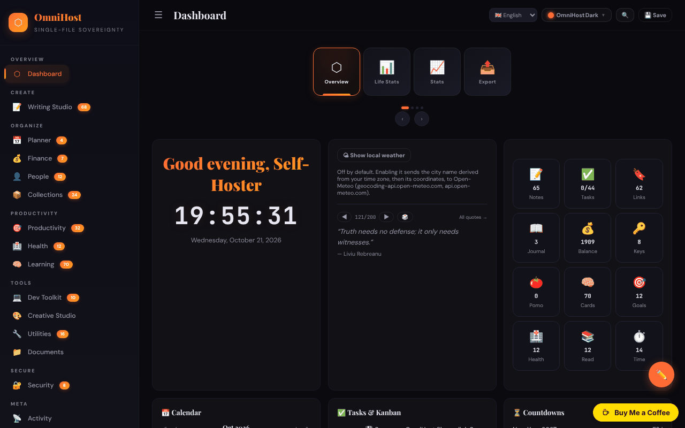

# OmniHost

**English** · [Română](README.ro.md) · [Français](README.fr.md) · [Italiano](README.it.md) · [Español](README.es.md) · [Português](README.pt.md) · [Deutsch](README.de.md) · [Magyar](README.hu.md)

**Version:** 2.0.0 · **Last updated:** 2026-10-26

A personal productivity suite in a single HTML file ("quine"): notes, planner, finance, learning, tools and many modules, inspired by YunoHost.

**Live:** https://chiuta.github.io/OmniHost/

## What it is

OmniHost is an `index.html` file (~4 MB) that works as a complete personal application, with no server and no account. The data is kept in a JSON object inside the file (`omnihost-store`); the "Save" button downloads a copy of the app with all the data embedded. The interface shows "141 Modules", and the description on the page calls it "Single-File Sovereignty". The default interface is in English.

## Features

The sidebars group the modules (with the number of items shown in the app):

- **Overview:** Dashboard (a card with greeting, clock, weather, quote, quick stats, calendar, tasks / Kanban, countdown, activity, "About OmniHost"), Life Stats, Stats, Export.
- **Create:** Writing Studio (Notes, Journal, Scratch, Blog, Meetings, Letters, Changelog, Knowledge, Citations, Editor, Prompts, Pipeline, Quotes).
- **Organize:** Planner (calendar, week, year, routines, meals, cleaning, sprint), Finance, People, Collections.
- **Productivity**, **Health**, **Learning** (including flashcards).
- **Tools:** Dev Toolkit, Creative Studio, Utilities (including dictionary and translation, QR generator and scanner), Documents.
- **Secure:** Security (including keys). **Meta:** Activity, Settings.
- Timelines (Universe, Galaxy, Solar System, geological, historical etc.) and a built-in wiki with module guides, in Notes.
- 30 visual themes and a "Custom Studio"; a dashboard edit mode (reordering by dragging, resizing).
- Interface in 71 languages, including Romanian.
- Quick module switcher (`Ctrl/Cmd+K`).
- JSON export / import, reset to "Clean Quine", source view and a "Licenses" page (credits for components, including jsQR and qrcodejs).

## New features (1.1.0)

- **Search in notes and journal** in the `Ctrl/Cmd+K` switcher: below the module list a section "In notes and journal" appears (BM25, typo tolerance, diacritics ignored); a click or Enter opens the note or journal entry.
- `.fff.json` backup (shared "fff-kit" module, local, no network): it opens from the dialog that appears when you click the version in the footer (export, password-encrypted export, import with confirmation, deletion of the app data). The backup covers the app database (`omnihost_db`); on import, the imported copy takes priority over the data in the file. An export marks the "last backup".
- The switcher dialog now has the dialog role (accessibility). The existing inline handlers were not modified.
- The texts of the switcher and of the notes/journal search (and the suffixes of the automatically generated accessible names) are available in 8 languages (ro, en, fr, it, es, pt, de, hu; the language is taken from the app settings); in the other languages of the interface they appear in English. The fr/it/es/pt/de/hu translations are automatic and **have not been verified by a native speaker.**
- `fff.config.json` marks the app as "self-modifying" (the Save button downloads a copy with the data embedded); the kit's dialog warns that the hash of the saved copy differs.

## User guide

1. Open `index.html`. On the Dashboard, go through the discovery tasks in the "Tasks" list.
2. Navigate between modules from the sidebar (☰ on narrow screens).
3. Change the language from the language selector in the top bar or from Settings.
4. Choose the theme from the "Theme" button (30 themes) or from "Custom Studio".
5. Add content in the modules ("+ Add" button; notes accept Markdown).
6. **To keep your data:** press "💾 Save" (or Settings → Save); a new HTML file is downloaded with all the data. Use that file from then on.
7. Backup: Settings → "Export JSON"; restore with the JSON import in Settings.
8. To reset the app and choose the language: Settings → "Clean Quine".
9. The dashboard cards can be reordered from "✏️ Edit Mode" (then "Done").

## Privacy and network

- **Storage:** the main data object is in the HTML file; in addition, `localStorage` uses the key `omnihost_db` (after "Save" it is rebuilt automatically, so that the `.fff.json` copy can include it). Unless you export it encrypted, the `.fff.json` copy contains the app's passwords and secrets as plain text: use the password-encrypted export.
- **Network:** the code contains a few third-party calls, limited by the CSP policy (`connect-src`) to four hosts; all of them go out only after an action of yours:
  - `geocoding-api.open-meteo.com` and `api.open-meteo.com` — the weather card on the Dashboard is **OFF by default**; on clicking "Show local weather" (opt-in, remembered in the settings in the file; it can be turned off with "Turn weather off"), the city deduced from the browser's time zone is sent for geocoding, then the coordinates for the forecast; the results are cached for 30 minutes. Without a click, no request goes out at load;
  - `api.dictionaryapi.dev` — only when you use the dictionary lookup (the searched word; possibly the pronunciation sound from the same host);
  - `api.mymemory.translated.net` — only when you use the translation in Utilities (the text to translate).
- **Passwords and secrets:** the Security/Passwords/TOTP modules keep the data as plain text in the JSON object in the file and in `localStorage` (`omnihost_db`); the "Encrypt" module is separate. The protection in the browser is only cosmetic (the note also appears on the Passwords page). The sample entries are public test credentials (the Stripe keys from the documentation were replaced with a placeholder). Do not store important passwords here on a shared computer and do not distribute the saved file.
- Links to other sites (e.g. github.com, trade-free.org, apps.yunohost.org) open only on click.
- No analytics, account or own server.

## Warning

A personal organization tool, for information only. The modules in the "Health" and "Finance" groups (symptom journal, allergies, supplements, financial calculators, tax estimator etc.) do not provide medical or financial advice and do not replace a specialist. The quotes and sample texts in the wiki are demonstration content and have not been checked for attribution.

## Running locally / offline

Download `index.html` (and the `vendor/` folder, which contains `jsQR.js` for the QR scanner) and open it in a browser. Almost all the modules work without internet; weather, dictionary and translation need a connection.

## License

MIT — see the LICENSE file. The "Licenses" page in the app, the file header and the wiki texts say the same (MIT). Third-party components (e.g. jsQR, qrcodejs) remain under their own licenses, listed on the "Licenses" page. NOTICE: the complete list of embedded third-party components (jsQR 1.4.0 Apache-2.0; the fonts JetBrains Mono, DM Sans, Playfair Display under SIL OFL 1.1; the Trade-Free logo; online services) with versions and copyrights is in [NOTICE.md](NOTICE.md).

## Audit

2026-10-10: verified in the browser (0 JS errors; at that date there was an automatic request to Open-Meteo, now removed). Fixed a stored XSS (the `priority` fields of tasks and `module` of the feed) that could be triggered through a malicious JSON import, plus accessibility (names for controls, contrast, Markdown lists). Round 2 (2026-10-11): the license unified to CC0 (the "Licenses" page, wiki, flashcard); the weather on the Dashboard is now opt-in (no automatic request at load); the static text "nothing is sent anywhere" in the About card was aligned with the one in i18n; the Stripe test keys replaced with a placeholder.

## History / Changelog

### 2.0.0 — 2026-10-26

- **Workspaces** (🗂 button in the top bar): module profiles — All, Home, Office, School — plus your own, saved from the current visibility (max 12). A workspace only hides sidebar pages; no data is deleted, and Dashboard and Settings always stay visible. Fix: hidden modules are now re-applied on startup.
- **Extended Ctrl/Cmd+K command bar**: switches workspaces and searches (typo-tolerant, diacritic-insensitive) local data in ~35 collections, not only notes and journal. Passwords, secure notes and health data are excluded. Modules on hidden pages no longer appear in the jump list.

### 1.3.10 — 2026-10-23

- Accessibility: on touch screens (`pointer:coarse`) small buttons, selects, text fields and the sidebar navigation are at least 44×44 px (they were 23–36 px). No change on desktop.

### 1.3.9 — 2026-10-22

Security: no more inline handlers, strict CSP, optional master password.

- **Event delegation:** all 1,395 inline handlers (`onclick=`, `onchange=`, `oninput=` etc., in the static HTML and in the JS templates) were replaced by `data-act` / `data-a1…` attributes and a single dispatcher on `document` that calls functions from a whitelist table (455 actions). Behaviour is unchanged (checked by an automatic equivalence reader: 1,190 of 1,191 distinct sites identical, the only difference being the random password generator).
- **Strict CSP:** `'unsafe-inline'` was removed from `script-src` (only `'self' blob:` and sha256 hashes of the real inline scripts); the exception was removed from `fff.config.json`; `fixcsp`, `info` and the strict `check` pass without exceptions. “Save Minified” no longer rewrites scripts (it would invalidate the hashes). `style-src` still allows `'unsafe-inline'`.
- **Optional master password** (Settings): encrypts the sensitive fields (passwords, 2FA keys, vault entries) with AES-256-GCM, PBKDF2-SHA256 600,000 iterations, a separate salt/IV per field; asked at the first access to the module, kept only in memory for the session (auto-lock after 15 min idle); change, disable, migration from plain text; messages in 8 languages. The `.fff.json` copy keeps these fields encrypted. There is no recovery: a lost master password cannot be reset except by erasing the protected data.
- The native `confirm`/`prompt` dialogs were replaced by in-page dialogs (shared `dialog` module); interface translations completed (i18n parity).
- Added `NOTICE.md` (third-party components). Fixed: the Scratchpad download used `document.URL` by mistake.
- Tests: `tests/master-pw.test.mjs` (new), `audit-r10`, `fff-r8` and `restore-r6` updated/passing.

### 1.3.8 — 2026-10-22

fff-kit 1.1.4: touch targets and minimum text size; touch targets and text size corrected.

- 1.3.7 — 2026-10-22: security. The data (localStorage, the copy embedded in the file and every imported JSON or `.fff.json` backup) is now validated against a schema: IDs must match `^[A-Za-z0-9_-]{1,64}$`, types and sizes are checked, unsafe keys (`__proto__` …) and texts are repaired or removed, with a message in 8 languages. Every value coming from the data and placed in an inline handler or a template is escaped (`jsa()`/`esc()`), so a hostile backup can no longer run code or read `localStorage.omnihost_db`. The unencrypted `.fff.json` copy of the kit no longer contains passwords, 2FA keys or vault entries (the copy made with a password stays complete and encrypted); a note in Settings explains it. Not done: the CSP still has `'unsafe-inline'` (about 1,390 inline handlers remain; their migration to `addEventListener` is a larger refactor). New test: `tests/audit-r10.test.mjs`.
- 1.3.6 — 2026-10-22: fff-kit 1.1.2: PBKDF2 600,000 iterations, anti-clickjacking protection
- 1.3.1 — 2026-10-19: the quick module switcher (`Ctrl/Cmd+K`, the 🔍 button) with the search in notes and journal, the automatic accessible names for controls without a label and the "last backup" hooks of the `.fff.json` copy (all described above) are present in the current version: they had been removed by mistake in an earlier cleanup and were restored, with their texts now in 8 languages. Fixed: script hashes added to the page's CSP next to `'unsafe-inline'` made the browser block every inline handler (`onclick=` etc.); the hashes were removed and the CSP keeps `script-src 'self' 'unsafe-inline' blob:` as before.

- 1.1.0 — 2026-10-14: fuzzy search in notes and journal in `Ctrl/Cmd+K` (FFF.search); `.fff.json` copy through the shared modules (core, label, bundle, search); new tests: `tests/fff-r8.test.mjs`.

- 1.0.0 — 2026-10-12: the version and the date of the last update are shown in the app (first numbered version; in the sidebar, with a label translated into the 71 languages).

**Round 7 — 11 October 2026**.
- Fixed: on narrow screens, the donation banner covered the footer note in the opened sidebar (the warning "Personal organizer, informational only…"); the sidebar now has space at the bottom for the banner (and loses it if the banner is hidden).
- Verified, not reproduced: the delay of the `load` event offline (in the test, `load` fires at ~0.9 s, network blocked).
- Unchanged: the inline handlers remain (the reason from Round 6 holds).

**Round 6 — 11 October 2026**.
- New: quick module switcher — `Ctrl/Cmd+K` or the 🔍 button in the top bar; it searches among the 141 modules by name or group, navigation with ↑↓, Enter opens. The `Esc` key now closes any dialog.
- Encrypt / Decrypt: a visible state (with `aria-live`) below the output field for success/failure, not just a toast.
- The top bar breaks into two rows on narrow screens (it no longer cuts off the buttons); the content has space at the bottom for the donation button.
- Unchanged: the inline handlers (~1400) remain — the file is saved as a "quine" through `outerHTML`, and "minify" rewrites the script, so a hash-based CSP would invalidate the saved files.

**Round 5 — 11 October 2026**.
- Decrypting with a wrong password now empties the output field (the old text no longer remains).
- The donation message no longer covers the dashboard's edit button (the button was moved higher; the content has space at the bottom); the message is a `complementary` landmark.
- Accessibility: a name for the language selector, correct heading order in the calendar; axe-core = 0 violations at 1280 and 360 px.
- Unchanged: the 1377 inline handlers (`onclick=` etc.) remain; the quality of the translations into the 71 languages cannot be verified.

## Author

Alexio — Alexandru-Ionuț Chiuță. Contact: alexio@trom.tf

## Summary

OmniHost is a single-file "quine" personal productivity suite (notes, planner, finance, learning, tools, security and more; 30 themes; UI in 71 languages). Data lives inside the HTML file and in localStorage (`omnihost_db`); "Save" downloads a copy with data baked in. Network use is limited to Open-Meteo (dashboard weather, opt-in), dictionaryapi.dev (dictionary) and MyMemory (translation). MIT licence.

### 1.3.5 — 2026-10-22
- Accessibility and mobile: one single H1 on the page (Markdown headings become H2), texts of at least 12px and touch targets of at least 24px.

### 1.3.4 — 2026-10-22
- Remaining English labels and texts in the other languages are translated (module descriptions, security checklist, HTTP reference, calendar month names, categories and statuses, exercises and meals, profile text) and the accessible names of the Translator and Dictionary language selectors now follow the interface language. Proper names, quotes, code and identifiers stay as authored.

### 1.3.3 — 2026-10-22
- The module documentation (guides and overviews) is now translated into all 8 languages, and the welcome content (tasks, journal, contacts, goals, recipes, flashcards and other demo data) follows the interface language, also when you switch it later. Edited items are left untouched; a few module labels were translated too (quotes keep their original language and attribution).

### 1.3.2 — 2026-10-22
- The sidebar disclaimer is now shown in a single language, and the welcome tasks, the demo activity feed and a few tooltips and labels are translated into the interface languages (the quote texts and the other demo data stay as authored).

