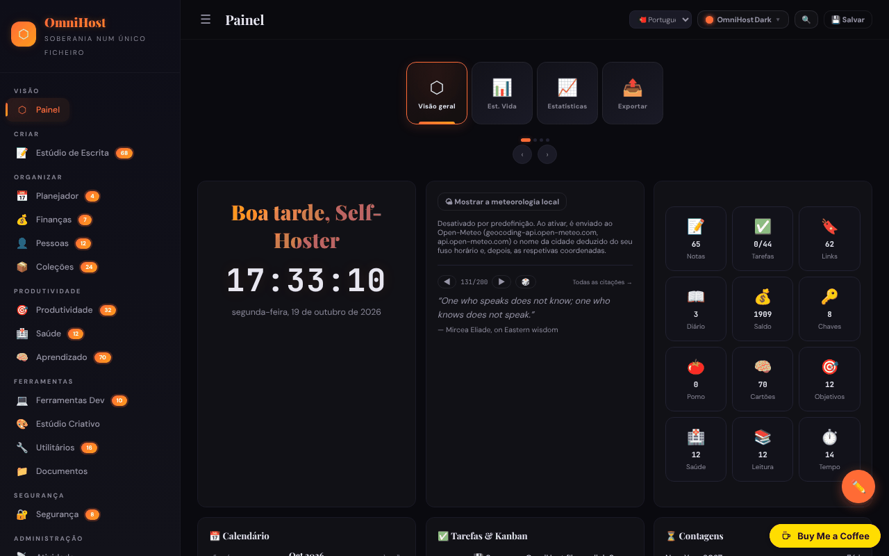

# OmniHost

[English](README.md) · [Română](README.ro.md) · [Français](README.fr.md) · [Italiano](README.it.md) · [Español](README.es.md) · **Português** · [Deutsch](README.de.md) · [Magyar](README.hu.md)

**Versão:** 1.3.0 · **Última atualização:** 2026-10-19

Suíte pessoal de produtividade num único ficheiro HTML («quine»): notas, planeador, finanças, aprendizagem, ferramentas e muitos módulos, inspirada no YunoHost.

**Online:** https://chiuta.github.io/OmniHost/

## O que é

O OmniHost é um ficheiro `index.html` (~4 MB) que funciona como uma aplicação pessoal completa, sem servidor e sem conta. Os dados são guardados num objeto JSON dentro do ficheiro (`omnihost-store`); o botão «Save» transfere uma cópia da aplicação com todos os dados incorporados. A interface apresenta «141 Modules», e a descrição da página chama-lhe «Single-File Sovereignty». A interface por omissão está em inglês.

## Funcionalidades

As barras laterais agrupam os módulos (com o número de elementos apresentado na aplicação):

- **Overview:** Dashboard (cartão com saudação, relógio, meteorologia, citação, estatísticas rápidas, calendário, tarefas / Kanban, contagem decrescente, atividade, «About OmniHost»), Life Stats, Stats, Export.
- **Create:** Writing Studio (Notes, Journal, Scratch, Blog, Meetings, Letters, Changelog, Knowledge, Citations, Editor, Prompts, Pipeline, Quotes).
- **Organize:** Planner (calendário, semana, ano, rotinas, refeições, limpeza, sprint), Finance, People, Collections.
- **Productivity**, **Health**, **Learning** (incluindo cartões / flashcards).
- **Tools:** Dev Toolkit, Creative Studio, Utilities (incluindo dicionário e tradução, gerador e leitor de QR), Documents.
- **Secure:** Security (incluindo chaves). **Meta:** Activity, Settings.
- Cronologias (Universo, Galáxia, Sistema Solar, geológica, histórica, etc.) e wiki integrada com guias dos módulos, em Notes.
- 30 temas visuais e um «Custom Studio»; modo de edição do painel (reordenação por arrastamento, redimensionamento).
- Interface em 71 línguas, incluindo o romeno.
- Alternador rápido de módulos (`Ctrl/Cmd+K`).
- Exportação / importação JSON, reposição para «Clean Quine», visualização do código-fonte e página «Licenses» (créditos dos componentes, incluindo jsQR e qrcodejs).

## Novas funcionalidades (1.1.0)

- **Pesquisa em notas e diário** no alternador `Ctrl/Cmd+K`: por baixo da lista de módulos surge a secção «Em notas e diário» (BM25, tolerância a erros de escrita, diacríticos ignorados); um clique ou Enter abre a nota ou a entrada do diário.
- Cópia de segurança `.fff.json` (módulo comum «fff-kit», local, sem rede): abre-se a partir do diálogo que aparece ao clicar na versão do rodapé (exportação, exportação cifrada com palavra-passe, importação com confirmação, eliminação dos dados da aplicação). A cópia inclui a base de dados da aplicação (`omnihost_db`); na importação, a cópia importada tem prioridade sobre os dados do ficheiro. Uma exportação marca a «última cópia de segurança».
- O diálogo do alternador tem agora o papel dialog (acessibilidade). Os manipuladores inline existentes não foram modificados.
- Os novos textos estão em romeno e inglês (as outras línguas usam inglês); **a tradução não foi verificada por um falante nativo.**
- `fff.config.json` marca a aplicação como «automodificável» (o botão Save transfere uma cópia com os dados incorporados); o diálogo do kit avisa que o hash da cópia guardada difere.

## Manual de utilização

1. Abre `index.html`. No Dashboard, percorre as tarefas de descoberta da lista «Tasks».
2. Navega entre módulos a partir da barra lateral (☰ em ecrãs estreitos).
3. Muda a língua no seletor de língua da barra superior ou em Settings.
4. Escolhe o tema no botão «Theme» (30 temas) ou em «Custom Studio».
5. Adiciona conteúdo nos módulos (botão «+ Add»; as notas aceitam Markdown).
6. **Para guardar os dados:** prime «💾 Save» (ou Settings → Save); é transferido um novo ficheiro HTML com todos os dados. Usa esse ficheiro a partir daí.
7. Cópia de segurança: Settings → «Export JSON»; restauro com a importação JSON em Settings.
8. Para repor a aplicação e escolher a língua: Settings → «Clean Quine».
9. Os cartões do painel podem ser reordenados em «✏️ Edit Mode» (depois «Done»).

## Privacidade e rede

- **Armazenamento:** o objeto de dados principal está no ficheiro HTML; além disso, o `localStorage` usa a chave `omnihost_db` (após «Save» é refeita automaticamente, para que a cópia `.fff.json` a possa incluir). Se não a exportares cifrada, a cópia `.fff.json` contém em texto simples as palavras-passe e os segredos da aplicação: usa a exportação cifrada com palavra-passe.
- **Rede:** o código contém algumas chamadas a terceiros, limitadas pela política CSP (`connect-src`) a quatro anfitriões; todas saem apenas após uma ação tua:
  - `geocoding-api.open-meteo.com` e `api.open-meteo.com` — o cartão da meteorologia no Dashboard está **DESLIGADO por omissão**; ao clicar em «Show local weather» (opt-in, memorizado nas definições do ficheiro; pode desligar-se com «Turn weather off»), a cidade deduzida do fuso horário do navegador é enviada para a geocodificação, depois as coordenadas para a previsão; os resultados ficam em cache durante 30 minutos. Sem clique, ao carregar não sai nenhum pedido;
  - `api.dictionaryapi.dev` — apenas quando usas a pesquisa no dicionário (a palavra pesquisada; eventualmente o som de pronúncia do mesmo anfitrião);
  - `api.mymemory.translated.net` — apenas quando usas a tradução em Utilities (o texto a traduzir).
- **Palavras-passe e segredos:** os módulos Security/Passwords/TOTP guardam os dados em texto simples no objeto JSON do ficheiro e no `localStorage` (`omnihost_db`); o módulo «Encrypt» é separado. A proteção no navegador é apenas cosmética (a nota aparece também na página Passwords). As entradas de exemplo são credenciais de teste públicas (as chaves Stripe da documentação foram substituídas por um marcador). Não guardes aqui palavras-passe importantes num computador partilhado e não distribuas o ficheiro guardado.
- As ligações para outros sítios (p. ex. github.com, trade-free.org, apps.yunohost.org) só se abrem ao clicar.
- Sem analítica, conta ou servidor próprio.

## Aviso

Ferramenta pessoal de organização, de caráter informativo. Os módulos dos grupos «Health» e «Finance» (diário de sintomas, alergias, suplementos, calculadoras financeiras, estimador de impostos, etc.) não fornecem aconselhamento médico ou financeiro e não substituem um especialista. As citações e os textos de exemplo da wiki são conteúdo de demonstração e não foram verificados quanto à atribuição.

## Execução local / offline

Transfere `index.html` (e a pasta `vendor/`, que contém `jsQR.js` para o leitor de QR) e abre-o num navegador. Quase todos os módulos funcionam sem internet; a meteorologia, o dicionário e a tradução precisam de ligação.

## Licença

MIT — ver o ficheiro LICENSE. A página «Licenses» da aplicação, o cabeçalho do ficheiro e os textos da wiki dizem o mesmo (MIT). Os componentes de terceiros (p. ex. jsQR, qrcodejs) mantêm-se sob as suas próprias licenças, listadas na página «Licenses».

## Auditoria

2026-10-10: verificado no navegador (0 erros de JS; nessa data existia um pedido automático ao Open-Meteo, entretanto removido). Corrigido um XSS armazenado (os campos `priority` das tarefas e `module` do feed) que podia ser desencadeado por uma importação JSON maliciosa, além de acessibilidade (nomes para controlos, contraste, listas Markdown). Ronda 2 (2026-10-11): licença unificada para CC0 (página «Licenses», wiki, flashcard); a meteorologia no Dashboard é agora opt-in (nenhum pedido automático ao carregar); o texto estático «nothing is sent anywhere» do cartão About foi alinhado com o do i18n; chaves de teste Stripe substituídas por um marcador.

## Histórico / Changelog

- 1.1.0 — 2026-10-14: pesquisa aproximada em notas e diário com `Ctrl/Cmd+K` (FFF.search); cópia `.fff.json` através dos módulos comuns (core, label, bundle, search); novos testes: `tests/fff-r8.test.mjs`.

- 1.0.0 — 2026-10-12: a versão e a data da última atualização são apresentadas na aplicação (primeira versão numerada; na barra lateral, com uma etiqueta traduzida nas 71 línguas).

**Ronda 7 — 11 de outubro de 2026**.
- Corrigido: em ecrãs estreitos, o banner de donativos cobria a nota de rodapé na barra lateral aberta (o aviso «Personal organizer, informational only…»); a barra lateral tem agora espaço em baixo para o banner (e perde-o se o banner estiver oculto).
- Verificado, não reproduzido: o atraso do evento `load` offline (no teste, `load` dispara aos ~0,9 s, com a rede bloqueada).
- Sem alterações: os manipuladores inline mantêm-se (o motivo da Ronda 6 mantém-se).

**Ronda 6 — 11 de outubro de 2026**.
- Novo: alternador rápido de módulos — `Ctrl/Cmd+K` ou o botão 🔍 da barra superior; pesquisa entre os 141 módulos por nome ou grupo, navegação com ↑↓, Enter abre. A tecla `Esc` fecha agora qualquer diálogo.
- Encrypt / Decrypt: estado visível (com `aria-live`) por baixo do campo de saída para sucesso/falha, não apenas um toast.
- A barra superior parte-se em duas linhas em ecrãs estreitos (já não corta os botões); o conteúdo tem espaço em baixo para o botão de donativos.
- Sem alterações: os manipuladores inline (~1400) mantêm-se — o ficheiro é guardado como «quine» através de `outerHTML`, e o «minify» reescreve o script, pelo que uma CSP por hash invalidaria os ficheiros guardados.

**Ronda 5 — 11 de outubro de 2026**.
- A decifragem com palavra-passe errada esvazia agora o campo de saída (o texto antigo já não permanece).
- A mensagem de donativos já não cobre o botão de edição do painel (o botão foi subido; o conteúdo tem espaço em baixo); a mensagem é um ponto de referência `complementary`.
- Acessibilidade: nome para o seletor de língua, ordem correta dos títulos no calendário; axe-core = 0 violações a 1280 e 360 px.
- Sem alterações: os 1377 manipuladores inline (`onclick=`, etc.) mantêm-se; a qualidade das traduções nas 71 línguas não é verificável.

## Autor

Alexio — Alexandru-Ionuț Chiuță. Contacto: alexio@trom.tf

## Resumo

O OmniHost é uma suíte pessoal de produtividade «quine» de ficheiro único (notas, planeador, finanças, aprendizagem, ferramentas, segurança e mais; 30 temas; interface em 71 línguas). Os dados vivem dentro do ficheiro HTML e no localStorage (`omnihost_db`); «Save» transfere uma cópia com os dados incorporados. A utilização da rede limita-se ao Open-Meteo (meteorologia do painel, opt-in), dictionaryapi.dev (dicionário) e MyMemory (tradução). Licença MIT.
