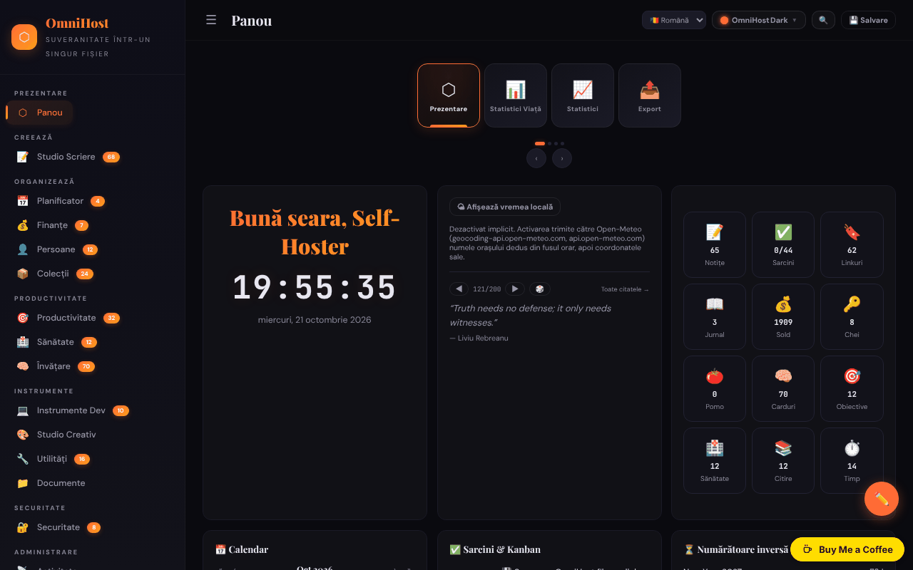

# OmniHost

[English](README.md) · **Română** · [Français](README.fr.md) · [Italiano](README.it.md) · [Español](README.es.md) · [Português](README.pt.md) · [Deutsch](README.de.md) · [Magyar](README.hu.md)

**Versiune:** 2.0.0 · **Ultima actualizare:** 2026-10-26

Suită personală de productivitate într-un singur fișier HTML („quine"): notițe, planificator, finanțe, învățare, instrumente și multe module, inspirată de YunoHost.

**Live:** https://chiuta.github.io/OmniHost/

## Ce este

OmniHost este un fișier `index.html` (~4 MB) care funcționează ca aplicație personală completă, fără server și fără cont. Datele sunt păstrate într-un obiect JSON în interiorul fișierului (`omnihost-store`); butonul „Save" descarcă o copie a aplicației cu toate datele încorporate. Interfața afișează „141 Modules", iar descrierea din pagină îl numește „Single-File Sovereignty". Interfața implicită este în engleză.

## Funcții

Barele laterale grupează modulele (cu numărul de elemente afișat în aplicație):

- **Overview:** Dashboard (card cu salut, ceas, vreme, citat, statistici rapide, calendar, sarcini / Kanban, numărătoare inversă, activitate, „About OmniHost"), Life Stats, Stats, Export.
- **Create:** Writing Studio (Notes, Journal, Scratch, Blog, Meetings, Letters, Changelog, Knowledge, Citations, Editor, Prompts, Pipeline, Quotes).
- **Organize:** Planner (calendar, săptămână, an, rutine, mese, curățenie, sprint), Finance, People, Collections.
- **Productivity**, **Health**, **Learning** (inclusiv cartonașe / flashcards).
- **Tools:** Dev Toolkit, Creative Studio, Utilities (inclusiv dicționar și traducere, generator și scanner QR), Documents.
- **Secure:** Security (inclusiv chei). **Meta:** Activity, Settings.
- Cronologii (Univers, Galaxie, Sistem Solar, geologică, istorică etc.) și wiki încorporat cu ghiduri pentru module, în Notes.
- 30 de teme vizuale și un „Custom Studio"; mod de editare a dashboardului (reordonare prin tragere, redimensionare).
- Interfață în 71 de limbi, inclusiv română.
- Comutator rapid de module (`Ctrl/Cmd+K`).
- Export / import JSON, resetare la „Clean Quine", vizualizare a sursei și pagină „Licenses" (credite pentru componente, inclusiv jsQR și qrcodejs).

## Funcții noi (1.1.0)

- **Căutare în notițe și jurnal** în comutatorul `Ctrl/Cmd+K`: sub lista de module apare secțiunea „În notițe și jurnal” (BM25, toleranță la greșeli de scriere, diacritice ignorate); clic sau Enter deschide notița sau intrarea de jurnal.
- Copie de siguranță `.fff.json` (modul comun „fff-kit”, local, fără rețea): se deschide din dialogul care apare la clic pe versiunea din subsol (export, export criptat cu parolă, import cu confirmare, ștergerea datelor aplicației). Copia cuprinde baza de date a aplicației (`omnihost_db`); la import, copia importată are prioritate față de datele din fișier. Un export marchează „ultima copie de siguranță”.
- Dialogul comutatorului are acum rol de dialog (accesibilitate). Handlerele inline existente nu au fost modificate.
- Textele comutatorului și ale căutării în notițe/jurnal (și sufixele numelor accesibile generate automat) există în 8 limbi (ro, en, fr, it, es, pt, de, hu; limba se ia din setările aplicației); în celelalte limbi ale interfeței apar în engleză. Traducerile în fr/it/es/pt/de/hu sunt automate și **nu au fost verificate de un vorbitor nativ.**
- `fff.config.json` marchează aplicația ca „auto-modificabilă” (butonul Save descarcă o copie cu datele încorporate); dialogul kitului avertizează că hash-ul copiei salvate diferă.

## Manual de utilizare

1. Deschideți `index.html`. Pe Dashboard parcurgeți sarcinile de descoperire din lista „Tasks".
2. Navigați din bara laterală (☰ pe ecrane înguste) între module.
3. Schimbați limba din selectorul de limbă din bara de sus sau din Settings.
4. Alegeți tema din butonul „Theme" (30 de teme) sau din „Custom Studio".
5. Adăugați conținut în module (butonul „+ Add"; notițele acceptă Markdown).
6. **Pentru a păstra datele:** apăsați „💾 Save" (sau Settings → Save); se descarcă un nou fișier HTML cu toate datele. Folosiți acel fișier de acum încolo.
7. Copie de siguranță: Settings → „Export JSON"; restaurare cu importul JSON din Settings.
8. Pentru a reseta aplicația și a alege limba: Settings → „Clean Quine".
9. Cardurile de pe dashboard pot fi reordonate din „✏️ Edit Mode" (apoi „Done").

## Confidențialitate și rețea

- **Stocare:** obiectul principal de date este în fișierul HTML; în plus, `localStorage` folosește cheia `omnihost_db` (după „Save” este refăcută automat, pentru ca copia `.fff.json` să o poată cuprinde). Copia `.fff.json` conține, ca text simplu, inclusiv parolele și secretele din aplicație dacă nu o exportați criptată: folosiți exportul criptat cu parolă.
- **Rețea:** codul conține câteva apeluri către terți, limitate de politica CSP (`connect-src`) la patru hosturi; toate pleacă doar după o acțiune a ta:
  - `geocoding-api.open-meteo.com` și `api.open-meteo.com` — cardul de vreme de pe Dashboard este **OPRIT implicit**; la clic pe „Show local weather” (opt-in, memorat în setările din fișier; se poate opri cu „Turn weather off”), orașul dedus din fusul orar al browserului este trimis pentru geocodare, apoi coordonatele pentru prognoză; rezultatele se păstrează în cache 30 de minute. Fără clic, la încărcare nu pleacă nicio cerere;
  - `api.dictionaryapi.dev` — doar când folosiți căutarea în dicționar (cuvântul căutat; eventual sunetul de pronunție de pe același host);
  - `api.mymemory.translated.net` — doar când folosiți traducerea din Utilities (textul de tradus).
- **Parole și secrete:** modulele Security/Passwords/TOTP păstrează datele ca text simplu în obiectul JSON din fișier și în `localStorage` (`omnihost_db`); modulul „Encrypt" este separat. Protecția din browser este doar cosmetică (nota apare și în pagina Passwords). Intrările de exemplu sunt credențiale de test publice (cheile Stripe din documentație au fost înlocuite cu un placeholder). Nu stocați aici parole importante pe un calculator partajat și nu distribuiți fișierul salvat.
- Linkurile către alte site-uri (de ex. github.com, trade-free.org, apps.yunohost.org) se deschid doar la clic.
- Fără analitice, cont sau server propriu.

## Avertisment

Instrument personal de organizare, cu caracter informativ. Modulele din grupele „Health" și „Finance" (jurnal de simptome, alergii, suplimente, calculatoare financiare, estimator de taxe etc.) nu oferă sfaturi medicale sau financiare și nu înlocuiesc un specialist. Citatele și textele-exemplu din wiki sunt conținut de demonstrație și nu au fost verificate pentru atribuire.

## Rulare locală / offline

Descărcați `index.html` (și folderul `vendor/`, care conține `jsQR.js` pentru scanner-ul QR) și deschideți-l în browser. Aproape toate modulele funcționează fără internet; vremea, dicționarul și traducerea necesită conexiune.

## Licență

MIT — vezi fișierul LICENSE. Pagina „Licenses” din aplicație, antetul fișierului și textele din wiki spun același lucru (MIT). Componentele terțe (de ex. jsQR, qrcodejs) rămân sub licențele lor proprii, listate în pagina „Licenses”. NOTICE: lista completă a componentelor terțe încorporate (jsQR 1.4.0 Apache-2.0; fonturile JetBrains Mono, DM Sans, Playfair Display sub SIL OFL 1.1; sigla Trade-Free; servicii online) cu versiuni și drepturi de autor este în [NOTICE.md](NOTICE.md).

## Audit

2026-10-10: verificat în browser (0 erori JS; la acea dată exista o cerere automată către Open-Meteo, acum eliminată). Corectat un XSS stocat (câmpurile `priority` din sarcini și `module` din feed) care putea fi declanșat printr-un import JSON malițios, plus accesibilitate (nume pentru controale, contrast, liste Markdown). Runda 2 (2026-10-11): licența unificată spre CC0 (pagina „Licenses", wiki, flashcard); vremea pe Dashboard este acum opt-in (nicio cerere automată la încărcare); textul static „nothing is sent anywhere" din cardul About a fost aliniat la cel din i18n; cheile de test Stripe înlocuite cu placeholder.

## Istoric / Changelog

### 2.0.0 — 2026-10-26

- **Spații de lucru** (butonul 🗂 din bara de sus): profiluri de module — Toate, Acasă, Birou, Școală — plus spații proprii salvate din vizibilitatea curentă (max. 12). Un spațiu doar ascunde paginile din bara laterală; nu șterge date, iar Dashboard și Setări rămân mereu vizibile. Corecție: modulele ascunse se reaplică acum și la pornire.
- **Bara de comenzi Ctrl/Cmd+K** extinsă: comută spațiile de lucru și caută (cu toleranță la greșeli și fără diacritice) în datele locale din ~35 de colecții (sarcini, contacte, rețete, semne de carte, carduri etc.), nu doar în notițe și jurnal. Parolele, notițele securizate și datele de sănătate nu sunt incluse. Modulele din pagini ascunse nu mai apar în comutator.

### 1.3.9 — 2026-10-22

Securitate: fără handlere inline, CSP strict, parolă principală opțională.

- **Delegare de evenimente:** toate cele 1.395 de handlere inline (`onclick=`, `onchange=`, `oninput=` etc., din HTML-ul static și din șabloanele JS) au fost înlocuite cu atribute `data-act` / `data-a1…` și un singur dispecer pe `document`, care apelează funcții dintr-un tabel de acțiuni permise (455 de acțiuni). Comportamentul este neschimbat (verificat cu un cititor automat de echivalență: 1.190 din 1.191 de locuri distincte identice; singura diferență este generatorul aleator de parole).
- **CSP strict:** `'unsafe-inline'` a fost scos din `script-src` (doar `'self' blob:` și hash-uri sha256 pentru scripturile inline reale); excepția a fost eliminată din `fff.config.json`; `fixcsp`, `info` și `check` strict trec fără excepții. „Save Minified” nu mai rescrie scripturile (ar invalida hash-urile). `style-src` mai permite `'unsafe-inline'`.
- **Parolă principală opțională** (Setări): criptează câmpurile sensibile (parole, chei 2FA, intrări din seif) cu AES-256-GCM, PBKDF2-SHA256 cu 600.000 de iterații, sare/IV separate pe câmp; cerută la prima accesare a modulului, ținută doar în memorie pe durata sesiunii (blocare automată după 15 min de inactivitate); schimbare, dezactivare, migrare din text clar; mesaje în 8 limbi. Copia `.fff.json` păstrează aceste câmpuri criptate. Nu există recuperare: o parolă principală pierdută nu poate fi resetată decât ștergând datele protejate.
- Dialogurile native `confirm`/`prompt` au fost înlocuite cu dialoguri în pagină (modulul comun `dialog`); traducerile interfeței au fost completate (paritate i18n).
- Adăugat `NOTICE.md` (componente terțe). Corectat: descărcarea din Scratchpad folosea din greșeală `document.URL`.
- Teste: `tests/master-pw.test.mjs` (nou), `audit-r10`, `fff-r8` și `restore-r6` actualizate/trecute.

### 1.3.8 — 2026-10-22

fff-kit 1.1.4: ținte tactile și text minim; ținte tactile/text corectate.

- 1.3.7 — 2026-10-22: securitate. Datele (localStorage, copia încorporată în fișier și orice copie JSON sau `.fff.json` importată) sunt acum validate pe o schemă: id-urile trebuie să respecte `^[A-Za-z0-9_-]{1,64}$`, se verifică tipurile și dimensiunile, cheile (`__proto__` …) și textele nesigure sunt reparate sau eliminate, cu mesaj în 8 limbi. Orice valoare venită din date și pusă într-un handler inline sau într-un șablon este escapată (`jsa()`/`esc()`), deci o copie ostilă nu mai poate rula cod și nici citi `localStorage.omnihost_db`. Copia `.fff.json` necriptată a kitului nu mai conține parole, chei 2FA și intrări din seif (copia făcută cu parolă rămâne completă și criptată); o notă în Setări explică acest lucru. Nefăcut: CSP are încă `'unsafe-inline'` (rămân circa 1.390 de handlere inline; migrarea lor la `addEventListener` e o refactorizare mai mare). Test nou: `tests/audit-r10.test.mjs`.
- 1.3.6 — 2026-10-22: fff-kit 1.1.2: PBKDF2 600 000 iterații, protecție anti-clickjacking
- 1.3.1 — 2026-10-19: comutatorul rapid de module (`Ctrl/Cmd+K`, butonul 🔍) cu căutarea în notițe și jurnal, numele accesibile automate pentru controalele fără etichetă și cârligele „ultima copie de siguranță” ale copiei `.fff.json` (toate descrise mai sus) sunt prezente în versiunea curentă: fuseseră eliminate din greșeală într-o curățare anterioară și au fost restaurate, cu textele lor acum în 8 limbi. Corectat: hash-urile de script adăugate în CSP-ul paginii alături de `'unsafe-inline'` făceau browserul să blocheze toate handlerele inline (`onclick=` etc.); hash-urile au fost eliminate, iar CSP păstrează `script-src 'self' 'unsafe-inline' blob:` ca înainte.

- 1.1.0 — 2026-10-14: căutare aproximativă în notițe și jurnal în `Ctrl/Cmd+K` (FFF.search); copie `.fff.json` prin modulele comune (core, label, bundle, search); teste noi: `tests/fff-r8.test.mjs`.

- 1.0.0 — 2026-10-12: versiunea și data ultimei actualizări sunt afișate în aplicație (prima versiune numerotată; în bara laterală, cu etichetă tradusă în cele 71 de limbi).

**Runda 7 — 11 octombrie 2026**.
- Corectat: pe ecrane înguste, bannerul de donații acoperea nota de subsol din bara laterală deschisă (avertismentul „Personal organizer, informational only…”); bara laterală are acum spațiu jos pentru banner (și îl pierde dacă bannerul este ascuns).
- Verificat, nereprodus: întârzierea evenimentului `load` în regim offline (în test, `load` se declanșează la ~0,9 s, rețeaua blocată).
- Neschimbat: handlerele inline rămân (motivul din Runda 6 se menține).

**Runda 6 — 11 octombrie 2026**.
- Nou: comutator rapid de module — `Ctrl/Cmd+K` sau butonul 🔍 din bara de sus; caută printre cele 141 de module după nume sau grup, navigare cu ↑↓, Enter deschide. Tasta `Esc` închide acum orice dialog.
- Encrypt / Decrypt: stare vizibilă (cu `aria-live`) sub câmpul de ieșire pentru succes/eșec, nu doar un toast.
- Bara de sus se rupe pe două rânduri pe ecrane înguste (nu mai taie butoanele); conținutul are spațiu jos pentru butonul de donații.
- Neschimbat: handlerele inline (~1400) rămân — fișierul se salvează ca „quine” prin `outerHTML`, iar „minify” rescrie scriptul, deci un CSP pe hash ar invalida fișierele salvate.

**Runda 5 — 11 octombrie 2026**.
- Decriptarea cu parolă greșită golește acum câmpul de ieșire (nu mai rămâne textul vechi).
- Mesajul de donații nu mai acoperă butonul de editare al dashboardului (butonul a fost mutat mai sus; conținutul are spațiu jos); mesajul este un reper `complementary`.
- Accesibilitate: nume pentru selectorul de limbă, ordine corectă a titlurilor în calendar; axe-core = 0 violări la 1280 și 360 px.
- Neschimbat: cele 1377 de handlere inline (`onclick=` etc.) rămân; calitatea traducerilor în cele 71 de limbi nu e verificabilă.

## Autor

Alexio — Alexandru-Ionuț Chiuță. Contact: alexio@trom.tf

## Rezumat

OmniHost este o suită personală de productivitate de tip „quine” într-un singur fișier (notițe, planificator, finanțe, învățare, instrumente, securitate și altele; 30 de teme; interfață în 71 de limbi). Datele se află în fișierul HTML și în localStorage (`omnihost_db`); „Salvează” descarcă o copie cu datele încorporate. Utilizarea rețelei se limitează la Open-Meteo (vremea din panou, opt-in), dictionaryapi.dev (dicționar) și MyMemory (traducere). Licență MIT.

### 1.3.5 — 2026-10-22
- Accesibilitate și mobil: un singur H1 pe pagină (titlurile Markdown devin H2), texte de minimum 12px și ținte tactile de minimum 24px.

### 1.3.4 — 2026-10-22
- Etichetele și textele rămase în engleză în celelalte limbi sunt traduse (descrieri de module, lista de securitate, referința HTTP, numele lunilor din calendar, categorii și stări, exerciții și mese, textul profilului), iar numele accesibile ale selectoarelor de limbă din Traducător și Dicționar urmează limba interfeței. Numele proprii, citatele, codul și identificatorii rămân ca în original.

### 1.3.3 — 2026-10-22
- Documentația modulelor (ghiduri și prezentări) este tradusă în toate cele 8 limbi, iar conținutul de bun venit (sarcini, jurnal, contacte, obiective, rețete, flashcard-uri și alte date demo) urmează limba interfeței, inclusiv la schimbarea ei ulterioară. Elementele editate de tine rămân neatinse; câteva etichete de module au fost traduse (citatele își păstrează limba originală și atribuirea).

### 1.3.2 — 2026-10-22
- Avertismentul din bara laterală apare acum într-o singură limbă, iar sarcinile de bun venit, fluxul de activitate demo și câteva tooltip-uri și etichete sunt traduse în limbile interfeței (textele citatelor și restul datelor demo rămân în forma originală).

